# Correlation

## Introduction

- Two quantitative measurements can be related.
- They are called the **dependent** variable ($Y$) and the **independent**
variable ($X$).

Q How can you describe the relationship between two numerical variables?

- **Correlation**: Describes the degree of **association** between variables.
- **Regression**: Describes the **effect** of variable $X$ on variable $Y$.

## Correlation

A **correlation** measures the "degree of association" between two variables.

Associations can be:

- **Positive**: An increase in one variable is associated with an increase in the other.
- **Negative**: An increase in one variable is associated with a decrease in the
other.

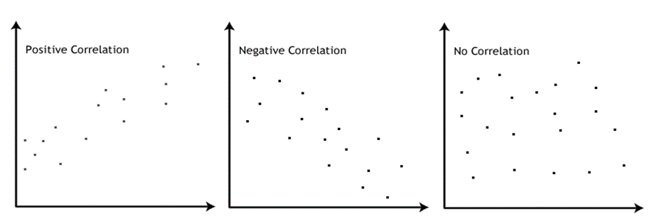

## Parametric & Non-Parametric

To measure the "degree of association" between:

- **2 continuous** variables (**normally** distributed) --> Pearson’s correlation coefficient
- **2 continuous** variables (**non normally** distributed) --> Spearman’s rank
- **2 categorical** variables (**ordinal**) --> Kendall’s Tau

::: {.callout-warning title="Reminder"}
Normality of variables is tested using the Shapiro-Wilk test:
Ho:variable normally distributed
:::

## Correlation-coefficient r

The **Pearson’s correlation coefficient** is defined as:

$$r = \frac{\sum (x - \bar{x})(y - \bar{y})}{\sqrt{\sum (x - \bar{x})^2 \sum (y - \bar{y})^2}}$$

It describes **how $Y$ varies with $X$** (numerator):

$-1 \leq r \leq 1$

$r = -1$   # 100% negative correlation
$r = 1$     # 100% positive correlation

## Interpreting $r$

| Value | Interpretation |
|---|---|
| $r = 0$ | no relationship |
| $\lvert r \rvert = 1$ | perfect linear relationship |
| $\lvert r \rvert < 0.3$ | weak relationship |
| $0.3 \leq \lvert r \rvert \leq 0.7$ | moderate relationship |
| $\lvert r \rvert > 0.7$ | strong relationship |

The **p-value** assigned to $r$ tells us how likely $r$ is right (i.e., confidence in our statement).

## Coefficient of determination r^2

Pearson’s $r$ can be squared, $r^2$, to derive a **coefficient of determination**.

It explains the portion of variability in one of the variables that can be accounted for by the variability in the second one.

Example: Correlation between 2 variables $X$ and $Y$

Pearson’s coefficient: $r$ = -0.7 --> $r^2$ = 0.49

49% of the variability in variable $X$ is determined by the variability of
variable $Y$.

## Visualization of Relation between two variables

Scatter-plot

- Displays the relationship between **2 continuous variables**.
- Each point represents the paired value of the variables for each
individual.
- Useful in the early stage of analysis when exploring data and
determining if a linear regression analysis is appropriate.

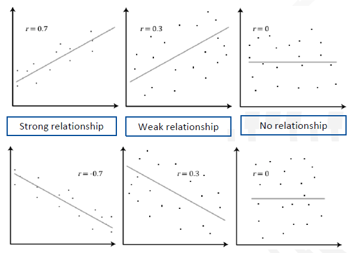

# Exercise 1 - Are age and resting systolic blood pressure (SBP) correlated?

SBP and Age

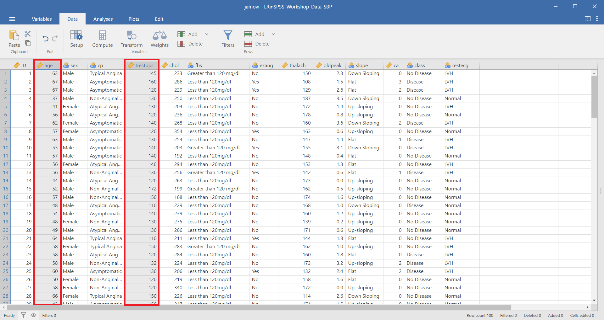

## Visualisation with scatter plots

1. From the top menu, select **Plots > Scatter Plot**.

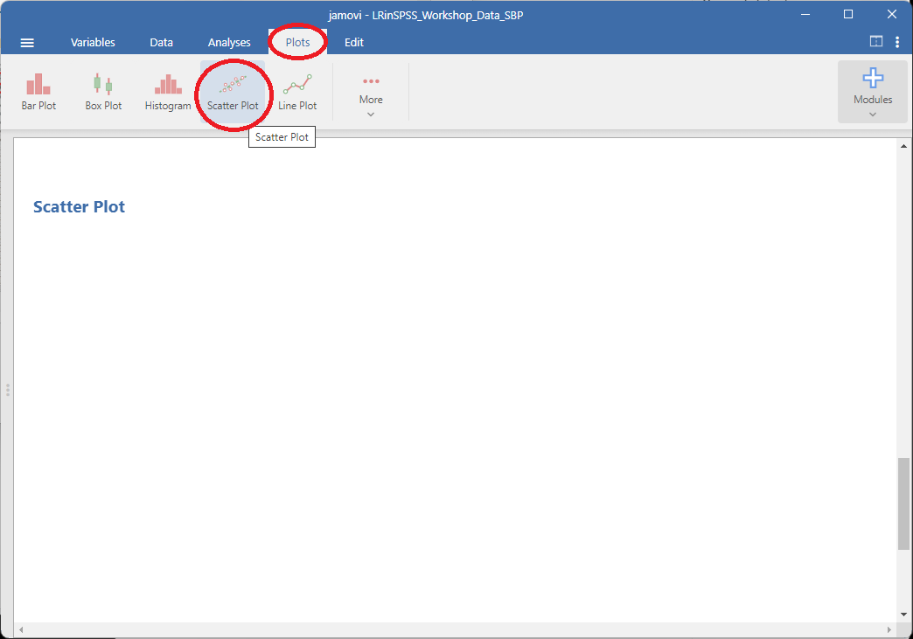

2. Move `age` into X-axis and `trestbps` to Y-axis produce a basic Scatter Plot.

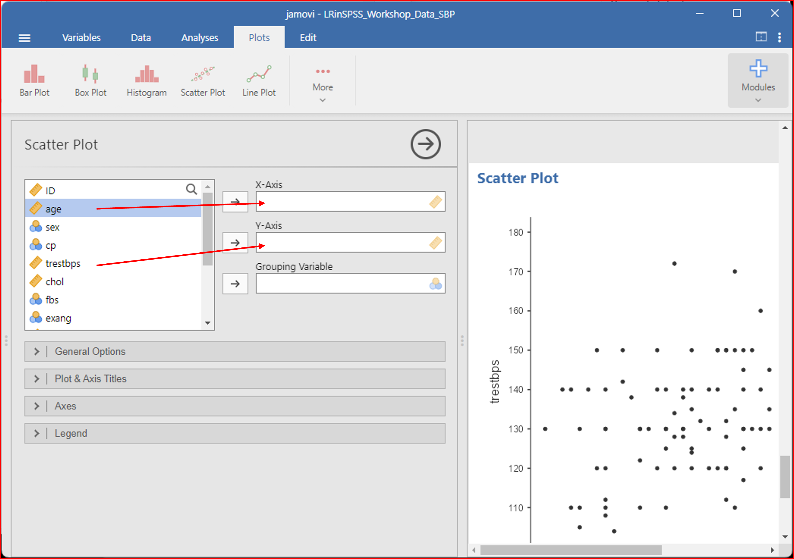

3. Under **General Options** check **Show line**.

- Select **Linear** for the Method
- Check with or without Confidence interval

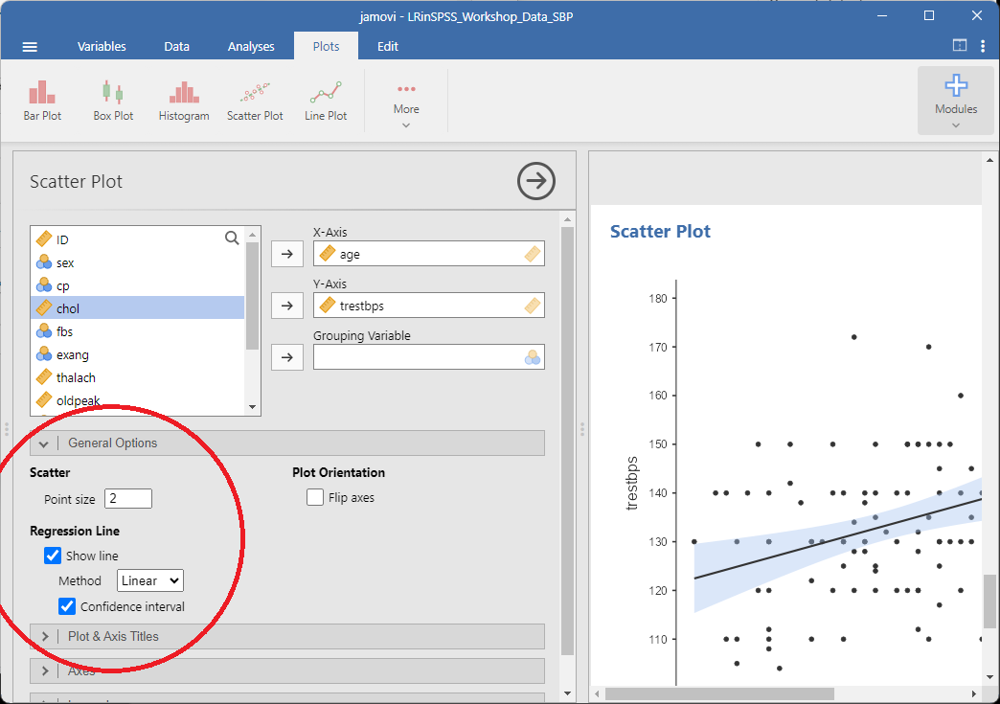

## Normality Check - Shapiro-Wilk test

Checking distribution of variables: Shapiro-Wilk test for Normality.

1. Select **Analyses > Exploration > Descriptives**.
2. Move `age` and `trestbps` into **Variables**.
3. Under **Statistics**, check **Shapiro-Wilk test**.
4. Under **Plots**, check **Histogram** and **Q-Q plot**.

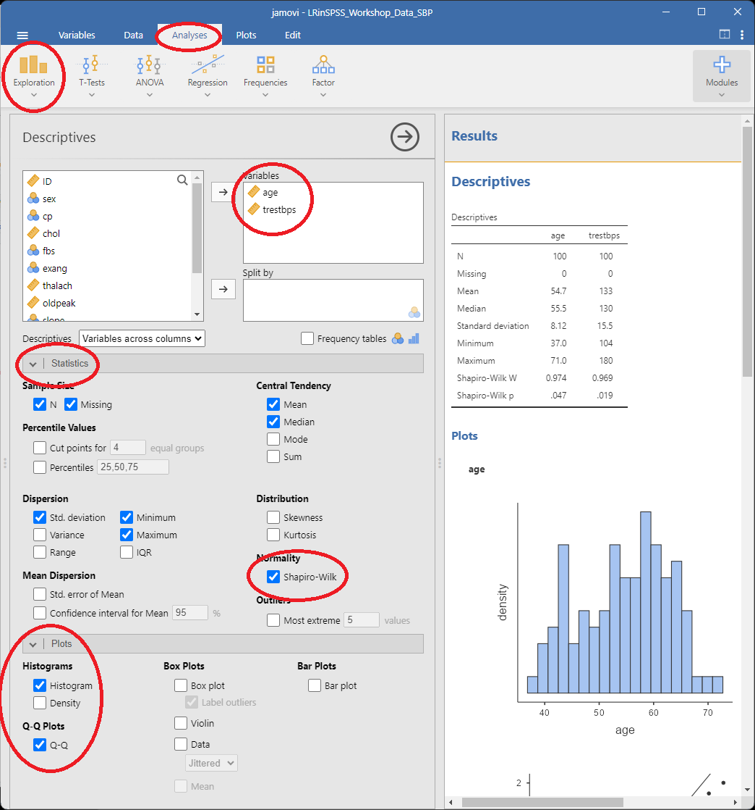
 
The **Results** panel will display a **Descriptives** table, histogram, and normality plots  (Normal Q-Q plots) for each of the variables selected.

Do they look normally distributed?
 
::: {layout-ncol=2}

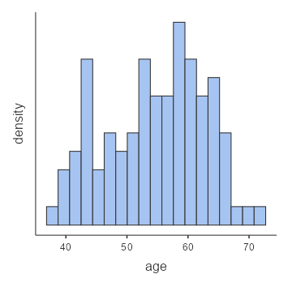

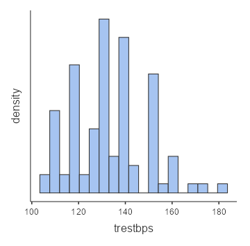

:::

::: {.callout-warning title="Recommendation"}
We highly recommend that you always plot your variables and their
relationships as well summarize them in statistical tables before
conducting a statistical test.

This gives you a reference point and helps identify if you make an error in the statistical test.

For brevity, we will not be doing this for every example in this workshop.

:::

## Descriptives table

The results of the Shapiro-Wilk test are presented in the **Descriptives** table in the **Results** panel.

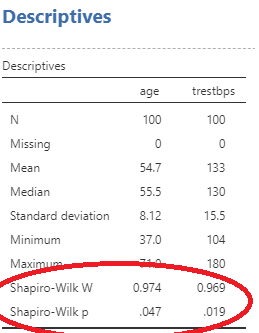
  
Both variables have a p-value of $p < 0.05$. 

Therefore we must use Spearman’s test.                         

## Spearman's

1. Select **Analyses > Regression > Correlation Matrix**.
2. Move `age` and `trestbps` into **Variables**.
3. Under **Correlation Coefficients**, check **Spearman**.

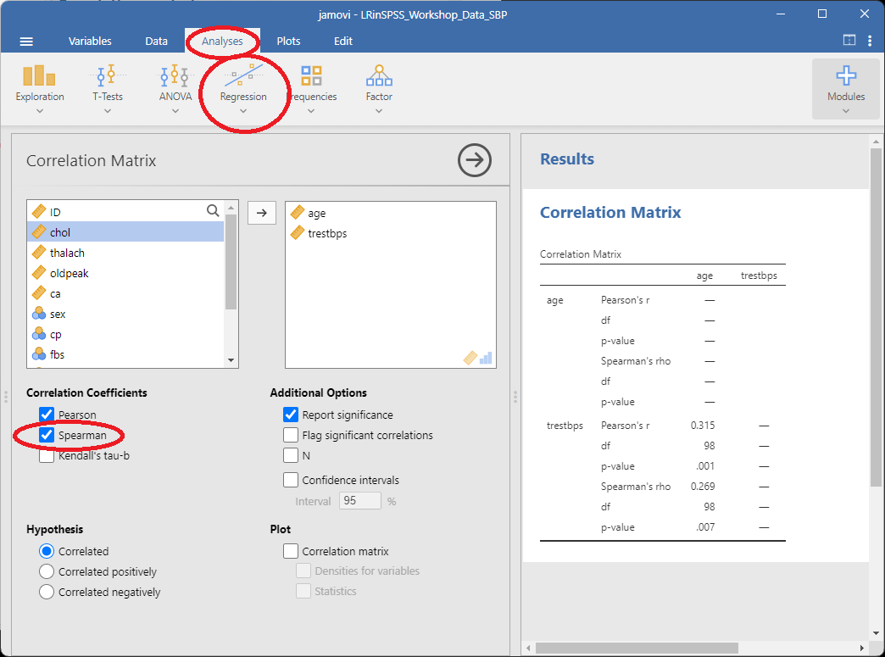

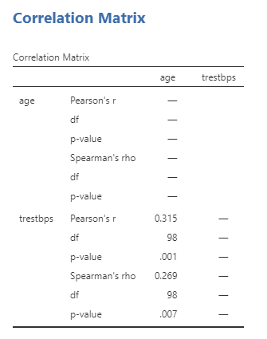

Interpretation: Spearman’s correlation is used to determine the
relationship between an individual’s age and their resting SBP.

There is a weak positive correlation between age and resting SBP
($r=0.269$) and the correlation is significantly different from 0
($p = 0.007$).

## Save the analysis

jamovi keeps the data, analyses and results together in a single **.omv** file. Saving the file allows you to reopen the analysis later with the results and analysis settings intact.

Let’s now save this file as well.

1. Open the File menu **(☰)** and select **Save As**.
2. Select **Browse** and navigate to the `Analysis` folder.
3. Enter a name for the file.
4. **Save** the file as a jamovi (.omv) file.

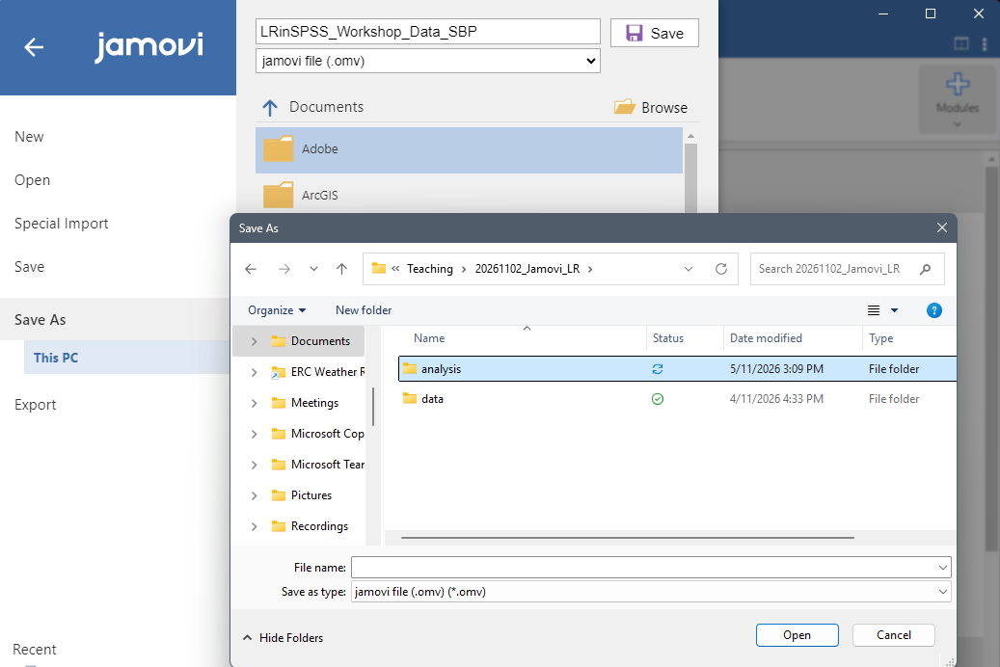

# Exercise 2 - Is Systolic Blood Pressure associated with other continuous variables of interest?

## Visualisation with matrix of scatter plots.

1. Select **Analyses > Regression > Correlation Matrix**.
2. Move `age`, `chol`, `oldpeak`, `thalach` and `trestbps` into **Variables**.
3. Under **Plots**, check **Correlation Matrix**.

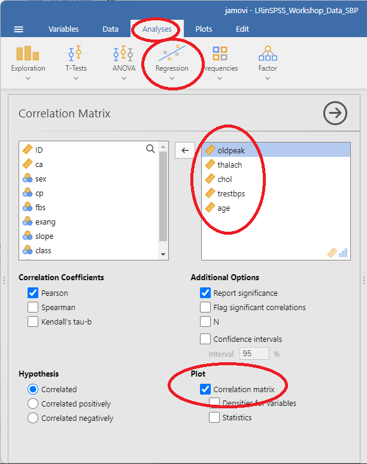

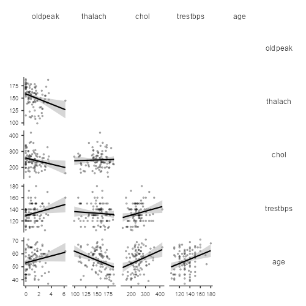

## Correlation analysis of multiple variables.

1. Select **Analyses > Regression > Correlation Matrix**.
2. Move `age`, `chol`, `oldpeak`, `thalach` and `trestbps` into **Variables**.
3. Under **Correlation Coefficients**, uncheck **Pearson** and check **Spearman**.

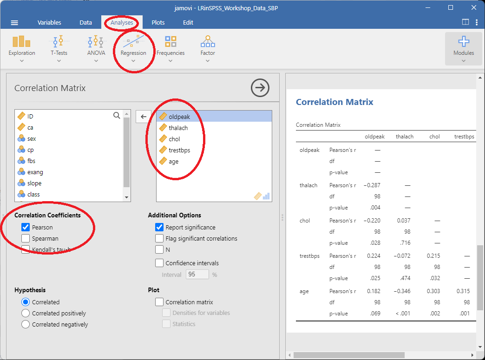

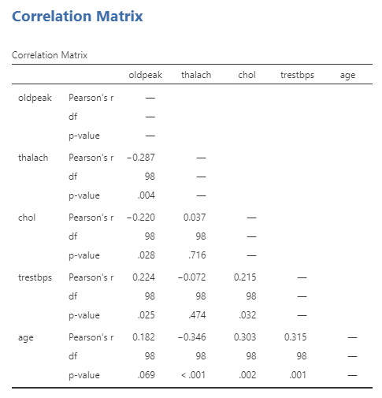

# Break for Morning Tea

 