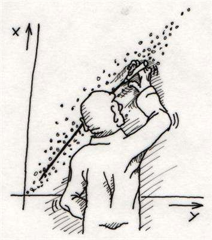
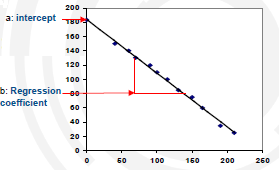
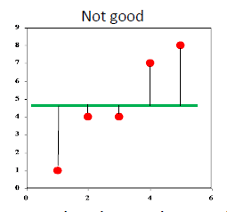
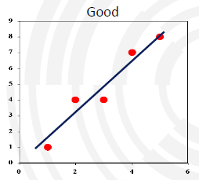
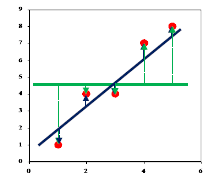
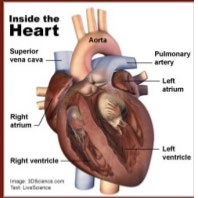
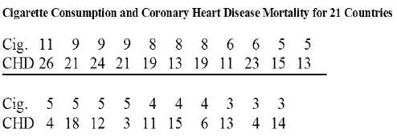
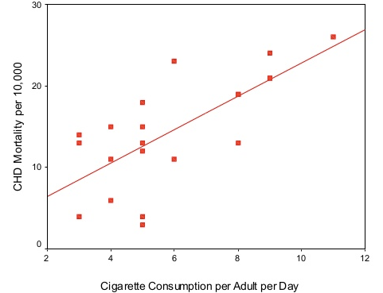
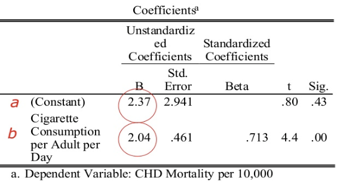
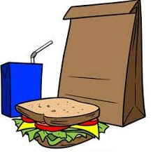

# Introduction - Linear Regression

::: {layout-ncol=2}

:::

In correlation, the two variables are treated as equals.

In regression, one variable is considered as:

- **Independent variable $X$** (predictor)
- **Dependent variable $Y$** (outcome)

## When to use regression analysis?

Regression analysis is used to describe the relationship between:

A single outcome variable: $y$, and
One or more predictor variables: $x_1, x_2, \ldots, x_k$

- If $k = 1$ : Simple linear regression
- If $k > 1$ : Multiple linear regression

Predicting $Y$ based on a given value of $X$

$X$ = Independent / Predictor variable (continuous, categorical or nominal)

$Y$ = Dependent / Outcome variable (continuous)    

$$
y = a + bx + e
$$

where:

- $y$ = the observed value of the outcome variable
- $a$ = the intercept
- $b$ = the regression coefficient (slope)
- $x$ = the value of the predictor variable
- $e$ = the error or residual

Test of significance: $b$ is significantly different from zero

Problem: To draw a straight line through the points that best explains the relationship.

::: {layout-ncol=2}

:::

Line can then be used to predict $Y$ from $X$.

## Least Squares Estimation

A good line is the one that minimises the **sum of squared differences** between the points and the line.

The smaller the sum of squared differences, the better the fit of the line to the data.

__Sum of squared differences:__

Green line:

(1-4.5)^2  +(4-4.5)^2 + (4-4.5)^2 + (7-4.5)^2  +(8-4.5)^2 = 31.25

Blue line:

(1-2)^2 + (4-3)^2 + (4-4.5)^2 + (7-6)^2 + (8-7.5)^2 = 3.5

## Least Squares Estimation (Background Information)

Using calculus, we get:

$$
b =
\frac{\sum (x_i - \bar{x})(y_i - \bar{y})}
     {\sum (x_i - \bar{x})^2}
=
\frac{\operatorname{Cov}(x,y)}
     {\operatorname{Var}(x)}
$$

$$
a = \bar{y} - b\bar{x}
$$

Coefficient $b$ is related to the correlation coefficient $r$.

If $X$ and $Y$ are positively correlated, then slope $b$ is positive.

$$
r = b\frac{SD_x}{SD_y}
$$

## Regression Hypothesis Tests

Is the slope significantly different from zero?

|  |  |
|---|---|
| Hypothesis | $H_0: b = 0$ (no relationship) |
|  | $H_1: b ≠ 0$ (linear relationship) |
| Test of significance | $T = b/SE(b)$ |
| Result | p-value significant or not |
| Conclusion | the slope is different from zero |
|  | significant linear relationship |

## Residuals
- The residual for observation $i(e_i)$ is the difference between its observed and predicted value:

$e_i = Y_i - \hat{Y}i$

- Check the assumptions of regression by examining the residuals
- Examine for linearity assumption
- Examine for constant variance for all levels of $X$ (homoscedasticity)
- Evaluate normal distribution assumption
- Evaluate independence assumption
- Check the presence of outliers

## Coefficient of determination ($R^2$)

$R^2$

- Represents the proportion of the dependent variable explained by the independent variable.
- Indicates how well the model fits the data.

**$R^2_{adjusted}$**

- Used for estimating explained variance in a population ($≠$ sample).
- Used when sample size is small and when results have to be generalized.

# Example: Effect of cigarette consumption on Coronary Heart Disease

::: {layout-ncol=2}

:::

**Research question**: How fast does CHD mortality rise depending on smoking?

CHD ($Y$ variable) = CHD mortality rate (deaths per 10,000 per year due to CHD)

Cig ($X$ variable) = average number of cigarettes per adult per day

## Scatter Plot with the line that best fits

## Linear regression equation:

$$
\hat{Y} = a + bX
$$

| Term | Meaning |
|---|---|
| $\hat{Y}$ | **Predicted value:** predicted value of $Y$ |
| $a$ | **Intercept:** value of $Y$ when $X = 0$ |
| $b$ | **Slope:** predicted change in $Y$ for each one-unit increase in $X$ |

## Linear regression equation:

$$
CHD_{pred} = a + b * Cig. cons
$$

| Term | Meaning |
|---|---|
| CHD_{pred} | **Predicted value:** predicted value of CHD |
| $a$ | **Intercept:** level of CHD when zero Cig is consumed |
| $b$ | **Slope:** rate of increase of CHD for each unit increase of Cig consumption |

## Regression coefficients:

p-value < 0.05 means $b$ is significantly different from zero.

There is a significant linear relationship between Cig consumption and CHD mortality.

## Regression model:

$$
\hat{Y} = a + bX = 2.37 + 2.04X
$$

- "CHD mortality" is equal to 2.37 when zero cigarette is consumed.
- "CHD mortality" is increased by 2.04 units per increase of "Cig consumption" units.

## Prediction:

What is the "CHD mortality" when cigarette consumption is 6?

$$
\hat{Y} = a + bX = 2.37 + 2.04(6) = 14.61
$$

We predict **14.61 / 10,000** people will die of CHD per annum in a country with an average consumption of *6* cigarettes per adult.

## Accuracy of prediction (residuals):

**Residuals** are the vertical distance between actual and predicted values.

$X = 6$ cigarettes per adult per day

**Prediction:** 14.61 deaths / 10,000

**What they actually have:** 23 deaths / 10,000

**Residual error for this case:** 23 - 14.61 = 8.39

**Explained variance:** 

$r = 0.71$

$r^2 = 0.71^2 = 0.51$

**Conclusion:** Almost 50% in variability of incidence of CHD mortality is associated with variability in smoking rates.

# Exercise 3 - Is Systolic Blood Pressure (SBP) associated with Age?

Visualisation with scatter plot.

The scatter plot allows one to check if there is a linear relationship (obtained in Exercise 1).

## Estimation of parameters

1. Select **Analyses > Regression > Linear Regression**.
2. Move `trestbps` into **Dependent Variable** and `age` into **Covariates**.
3. Under **Model Fit**, check **$R$**, **$R^2$**, and **$R^2_{adjusted}$**.
4. Under **Model Coefficients**, check **ANOVA test** and **Confidence interval**. Leave the interval at 95%.

## Model Summary

Model Fit Measures:

- $R$: **Pearson Correlation Coefficient** between `Age` and `Systolic Blood Pressure (SBP)` of **0.315**.

- $R^2_{adjusted}$: **Coefficient of determination** of **0.09**, meaning that `Age` accounts for *~ 9%* of the variation of `SBP`.

ANOVA Test:

- $p$: **Significance** level associated to F-ratio. It is < 0.05. Meaning that the regression model predicts `SBP` significantly well.

Model Coefficients:

- **Predictor**: Estimations of model parameters – Intersect($a$) and Slope Coefficient ($b$).

`Age` has a significant effect on `SBP` ($p < 0.05$). For one year increase in age there was **0.604** unit increase in SBP level.

- **95% C.I. for $b$**: SBP level increases by between **0.24** and **0.97** mmHg by one year increase in age.

## Confidence and prediction

- **Confidence intervals** tell how well you have determined the estimate parameter. The standard error for a CI takes into account the uncertainty due to sampling.
- **Prediction intervals** tell where you can expect to see the next data point sampled (give a range for $y$ itself). The standard error for a PI takes into account the uncertainty due to sampling + the variability of the individuals around the predicted mean.
- Both intervals will be centered around the same value, but the standard errors will be different. A prediction interval is always wider than a confidence interval.

1. In the **Results** panel, click anywhere within the **Linear Regression** results section to reopen the **Analyses** panel options.
2. Under **Save**, check **Predicted Values** and **Residuals**.

3. Select **Data** from the top menu. 
4. Scroll to the right of the data frame to view two additional columns for each of the items selected.

New variables were generated:

- Predicted values of `SBP` for each value of `Age`.
- Estimated residuals.

<!--
TODO: Instructor review.
The original workshop has columns for CI on each of the above. jamovi has no equivalent.
-->

## What can go wrong?

Violations:

- In the linear regression model:

  - Nonlinearity (e.g. quadratic relationship, higher order terms)
  - Level of measurement incorrect
  - Sample size too small
  
  
- In the residual assumptions:

  - Non-normal distribution
  - Non-constant variance
  - Dependency
  - Outliers

Checks:

| Assumption | Check |
|---|---|
| Level of measurement | Check outcome and predictor variable types |
| Sample size | Sample is at least 10 or 20 subjects |
| Linearity | Plot residuals against the predictor or fitted values |
| Normality of residuals | Check the residual Q-Q plot |
| Constant variance of residuals | Check residuals against fitted values |
| Observations are independent | Check residuals against fitted values |
| Outliers and influential observations | Check residuals vs. fitted values plot |

## Check: Level of measurement

For linear regression:

- **Dependent variable:** continuous
- **Independent variables:** continuous or categorical

For this analysis:

- Outcome: `trestbps` — **continuous**
- Predictor: `age` — **continuous**

Therefore, the measurement levels are appropriate for the model.

## Check: Sample size

For this analysis:

$$ n = 100 $$

and

$$ m = 1 $$

where:

- $n$ = number of observations
- $m$ = number of independent variables

Therefore:

$$
n \gg m
$$

<!--
TODO: Instructor review.
The original workshop teaches 10–20 observations per predictor as a
sample-size rule. This is a rule of thumb rather than a general
requirement for linear regression. Consider revising in a later
content-review pass.
-->

## Check: Linearity between outcome and predictor               

Plot residuals vs. predictor variable.

1. From the top menu, select **Plots > Scatter Plot**.
2. Move `age` into **X-Axis** and `Residuals` into **Y-Axis**.
3. Under **General Options** check **Show line**.

- Select **Linear** for the Method
- Check with or without Confidence interval

A well-behaved "residuals vs. predictor plot" will bounce randomly and form a roughly horizontal band around the residual = 0 line.

## Check: Normality of residuals

Check the residual Q-Q plot.

1. In the **Results** panel, click anywhere within the **Linear Regression** results section to reopen the **Analyses** panel options.
2. Under **Assumption Checks** check **Q-Q plot of residuals**.

A well-behaved "Normal Q-Q plot" roughly lines the points along the diagonal line. This suggests that the residuals are normally distributed.

## Check: Homoscedasticity, Independence and outliers

1. From the top menu, select **Plots > Scatter Plot**.
2. Move `Predicted values` into **X-Axis** and `Residuals` into **Y-Axis**.

A well-behaved "residuals vs. fitted values plot" roughly form a "horizontal band" around the residual = 0 line. This suggests that the variances of the error terms are equal, and observations are independent. No one residual stands out from the basic random pattern of residuals (no outliers).

Residual analysis for Homoscedasticity

Residual analysis for Independence of observations

No extreme outliers

Cases with extreme values that differ greatly from the rest of your sample.

Even a few outliers can dramatically change estimates of the slope ($b$).

Outliers can result from:

- Errors in coding or data entry (→ rectify).
- Impossible values in real life (→ exclude).
- Or sometimes they reflect important "real" variation (→ include, run the analysis both with and without it).

If you see no reason why your outliers are erroneous measurements
→ there is no truly objective way to remove them.

| Assumption | Check | Met
|---|---|---|
| Level of measurement | Check outcome and predictor variable types | Yes |
| Sample size | Sample is at least 10 or 20 subjects | Yes |
| Linearity | Plot residuals against the predictor or fitted values | Yes |
| Normality of residuals | Check the residual Q-Q plot | Yes |
| Constant variance of residuals | Check residuals against fitted values | Yes |
| Observations are independent | Check residuals against fitted values | Yes |
| Outliers and influential observations | Check residuals vs. fitted values plot | Yes |

# Exercise 4 - Is Systolic Blood Pressure (SBP) associated with Gender?

Visualisation with box plots.

1. From the top menu, select **Plots > Box Plot**.
2. Move `trestbps` into **Variable** and `sex` into **Grouping Variable 1**.

## Estimation of parameters

1. Select **Analyses > Regression > Linear Regression**.
2. Move `trestbps` into **Dependent Variable** and `sex` into **Factors**.
3. Under **Model Fit**, check **$R$**, **$R^2$**, and **$R^2_{adjusted}$**.
4. Under **Model Coefficients**, check **ANOVA test** and **Confidence interval**. Leave the interval at 95%.

## Model Summary

Model Fit Measures:

- $R^2_{adjusted}$: **Coefficient of determination** of **0.012**, meaning that gender accounts for *~ 1.2%* of the variation of `SBP`.

ANOVA Test:

- $p$: **Significance** level is > 0.05. Meaning that the regression model does not predict `SBP` significantly well.

Model Coefficients:

- **Predictor**: Estimations of model parameters – Intersect($a$) and Slope Coefficient ($b$).

Gender has an insignificant effect on `SBP` ($p > 0.05$). $b = -5.07$ is the average difference in SBP between the reference group (Females) and the comparison group (Males).

- **95% C.I. for $b$**: There was no difference in `SBP` between males and females which was confirmed by C.I. containing the value 0.

