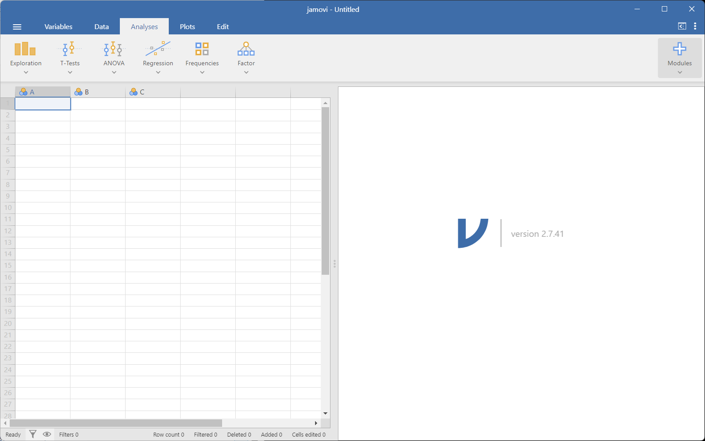
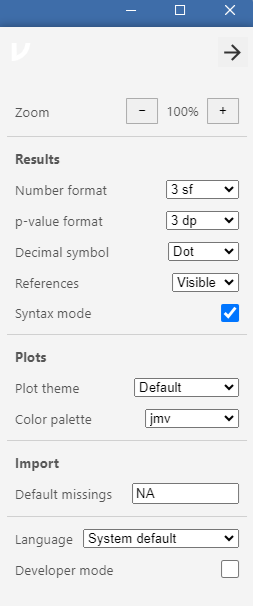

::: {.callout-warning title="Migration draft"}
This version deliberately preserves the original slide order, only with reduced signposting. Exercises and wording are as as close to original as possible. Items needing review are marked as internal comments with 'TODO's.
:::

# Overview

## Part 1: Correlation

1. Pearson’s correlation coefficient
2. Spearman’s correlation coefficient

[Start Part 1](01-correlation.qmd)

## Part 2: Simple Linear Regression

1. Least squares estimation
2. Hypothesis testing
3. Example

[Start Part 2](02-simple-linear-regression.qmd)

## Part 3: Multiple Linear Regression

1. Assumptions
2. Example

[Start Part 3](03-multiple-linear-regression.qmd)

::: {.callout-warning title="SPSS License"}
Reminder

If you are using a university license to run SPSS, you may find that you can only run it if you are connected to your university network –this can be either through a direct on-campus ethernet cable, or by connecting to the university VPN if you are on a wireless network or off campus.
:::

# Agenda

| Time | Topic |
|---|---|
| 09:00 | Welcome, correlation theory and Exercises 1-2 |
| 10:30 | Morning tea |
| 11:00 | Simple linear regression and Exercises 3-4 |
| 12:30 | Lunch |
| 13:30 | Multiple linear regression and Exercise 5 |
| 15:00 | Afternoon tea |
| 15:30 | Extended beta-carotene exercise |
| 17.50 | Post-workshop survey |
| 17:00 | Close |

# Starting jamovi

# Open today’s data file

1. Download the workshop materials into your local drive.
2. At the top left hand corner, select from the File menu **(☰) > Open > <path to data folder>**.
3. In the **Data** folder select and **Open** the file `LRinSPSS_Workshop_Data_SBP.sav`.

# The jamovi Graphical User Interface (GUI)

- **File menu**  
  Create, open, save and export data and jamovi (`.omv`) files.

- **Variables**  
  View and change how variables are defined, including their name, description, data type and measurement level.

- **Data**  
  View and edit the dataset, create computed or transformed variables, and apply filters.

- **Analyses**  
  Select and configure statistical analyses. The available analyses include exploration, regression, frequencies, ANOVA and other statistical procedures.

- **Results panel**  
  Displays tables, statistics and plots produced by your analyses. Select an existing result to return to its analysis options.

- **Syntax mode**  
  When enabled, displays the analysis syntax generated from your selections in the graphical interface.

<!--
TODO Do we want to present this here?
## Syntax

jamovi syntax (code) is based on the **R programming language**, which provides an alternative to the drop-down menus for data manipulation and statistical analyses. The syntax is automatically generated as you use the user interface.

To view and copy the Syntax code:

- Toggle Syntax Mode: Click the Application menu **(:)**
- Enable R Code: Check the box next to Syntax mode
- Extract Code: Right-click on any analysis output and select Copy syntax

-->

# References

- [jamovi Documentation](https://docs.jamovi.org/) – reference material for working with   data and performing analyses in jamovi.

- [Laerd Statistics](https://statistics.laerd.com/features-overview.php) – tutorials covering statistical methods, assumptions, interpretation and reporting.

- [Discovering Statistics](https://www.discoveringstatistics.com) by Andy Field – books, tutorials, videos and other resources for learning statistics.

- [Learning Statistics with jamovi](https://www.learnstatswithjamovi.com/) - A Tutorial for Beginners in Statistical Analysis. Open Book Publishers.

# Exercise 1 - Determinants of Resting Systolic Blood Pressure

- Cross-sectional study investigating the **relationship** between **resting
systolic blood pressure (SBP)** and **various risk factors**.
- $N = 100$ heart disease patients from Cleveland, USA.
- [Original data](https://www.kaggle.com/kingabzpro/heart-disease-from-cleveland) has 300 participants which was truncated for our exercise. 

## Data dictionary

| Variable | Description | Suggested measure type |
|---|---|---|
| `age` | Age in years | Continuous |
| `sex` | 0 = female, 1 = male | Nominal |
| `cp` | Chest pain category | Nominal |
| `trestbps` | Resting systolic BP in mmHg | Continuous |
| `chol` | Blood cholesterol in mg/dL | Continuous |
| `fbs` | Fasting blood sugar: 0 = <=120 mg/dL, 1 = >120 mg/dL | Nominal |
| `exang` | Exercise-induced angina: 0 = no, 1 = yes | Nominal |
| `thalach` | Maximum heart rate achieved in bpm | Continuous |
| `oldpeak` | ST-wave depression induced by exercise | Continuous |
| `slope` | Peak exercise ST-segment slope | Ordinal |
| `ca` | Number of major vessels coloured by fluoroscopy | Ordinal |
| `class` | Diagnosis: 0 = no disease, 1 = disease | Nominal |
| `restecg` | Resting ECG category | Nominal |

# Contacts

[biostats@qcif.edu.au](biostats@qcif.edu.au)

Support requests:

[https://support.qcif.edu.au/](https://support.qcif.edu.au/)

QFAB’s education and training resources:

[https://www.qcif.edu.au/training/about-our-training/](https://www.qcif.edu.au/training/about-our-training/)

[training@qcif.edu.au](training@qcif.edu.au)

[www.qcif.edu.au](www.qcif.edu.au)

