::: {.callout-warning title="Migration draft"}
This version deliberately preserves the original slide order, repeated signposting, exercises and wording as closely as possible. SPSS interface images/actions are marked for replacement with jamovi equivalents. Statistical content is not silently redesigned; items needing review are marked separately.
:::

# Exploring and Predicting Using Linear Regression in jamvi

We acknowledge and celebrate the First Australians on whose traditional lands we meet, and we pay our respect to the Elders past and present.

<!-- Overview -->
## Overview

### Part 1: Correlation

1. Pearson’s correlation coefficient
2. Spearman’s correlation coefficient

### Part 2: Simple Linear Regression

1. Least squares estimation
2. Hypothesis testing
3. Example

### Part 3: Multiple Linear Regression

1. Assumptions
2. Example

::: {.callout-warning title="SPSS License"}
Reminder

If you are using a university license to run SPSS, you may find that you can only run it if you are connected to your university network –this can be either through a direct on-campus ethernet cable, or by connecting to the university VPN if you are on a wireless network or off campus.
:::

<!-- Agenda -->
## Agenda

| Time | Topic |
|---|---|
| 09:00 | Welcome, correlation theory and Exercises 1-2 |
| 10:30 | Morning tea |
| 11:00 | Simple linear regression and Exercises 3-4 |
| 12:30 | Lunch |
| 13:30 | Multiple linear regression and Exercise 5 |
| 15:00 | Afternoon tea |
| 15:30 | Extended beta-carotene exercise |
| 17.50 | Post-workshop survey |
| 17:00 | Close |

<!-- Starting jamovi -->
## Starting jamovi

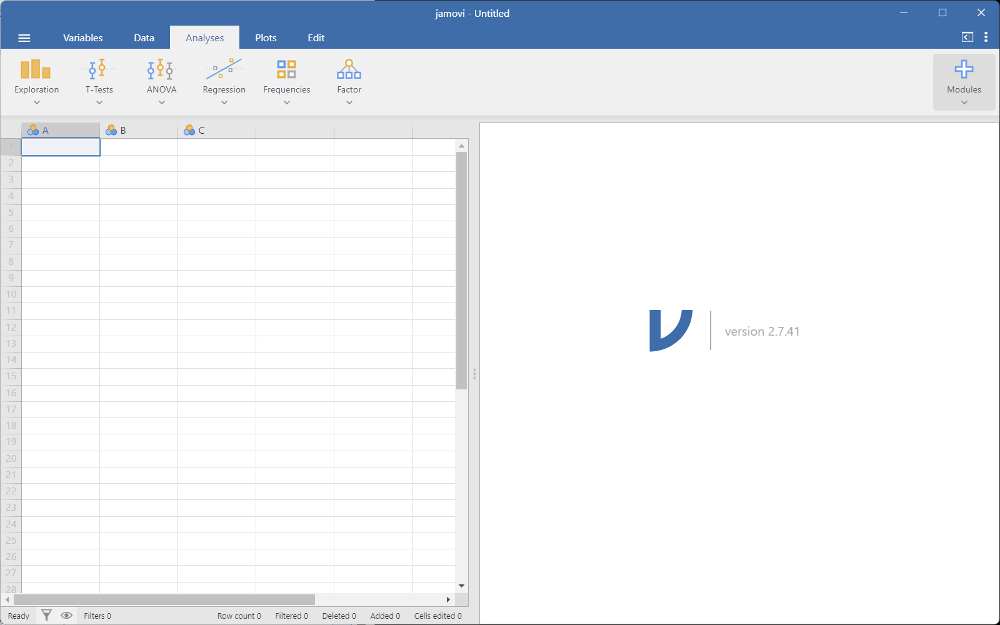

<!-- Data -->
### Open today’s data file

1. Download the workshop materials into your local drive.
2. At the top left hand corner, select from the File menu **(☰) > Open > <path to data folder>**.
3. In the Data folder select and **Open** the file.
LRinSPSS_Workshop_Data_SBP.sav

<!-- GUI -->
### Graphical User Interface (GUI)

- Data View window (where the data is stored)
- Variable View window (who the data is defined)
- Menu (File Edit View Data … etc.)
- Drop-down options
- Dialog boxes
- Output window (script and results)
- Help

<!-- Syntax -->
### Syntax

jamovi syntax is based on the **R programming language**, which provides an alternative to the drop-down menus for data manipulation and statistical analyses.

The Syntax mode window is accessed by clicking the Application menu **(:)** and ticking the **Syntax mode** check box. This is where users can view and copy the underlying R code for their analyses.

In jamovi, the syntax is automatically generated as you use the user interface.

To view and copy the Syntax code:

- Toggle Syntax Mode: Click the Application menu **(:)**
- Enable R Code: Check the box next to Syntax mode
- Extract Code: Right-click on any analysis output and select Copy syntax

<!-- References -->
### References

> **JAMOVI TODO:** add links to new references

<!-- Exercise 1 -->
## Exercise 1 Determinants of Resting Systolic Blood Pressure

- Cross-sectional study investigating the **relationship** between **resting
systolic blood pressure (SBP)** and **various risk factors**.

- N = 100 heart disease patients from Cleveland, USA.

- [Original data](https://www.kaggle.com/kingabzpro/heart-disease-from-cleveland) has 300 participants which was truncated for our exercise. 

<!-- data dictionary -->
## Data dictionary

| Variable | Description | Suggested measure type |
|---|---|---|
| `age` | Age in years | Continuous |
| `sex` | 0 = female, 1 = male | Nominal |
| `cp` | Chest pain category | Nominal |
| `trestbps` | Resting systolic BP in mmHg | Continuous |
| `chol` | Blood cholesterol in mg/dL | Continuous |
| `fbs` | Fasting blood sugar: 0 = <=120 mg/dL, 1 = >120 mg/dL | Nominal |
| `exang` | Exercise-induced angina: 0 = no, 1 = yes | Nominal |
| `thalach` | Maximum heart rate achieved in bpm | Continuous |
| `oldpeak` | ST-wave depression induced by exercise | Continuous |
| `slope` | Peak exercise ST-segment slope | Ordinal |
| `ca` | Number of major vessels coloured by fluoroscopy | Ordinal |
| `class` | Diagnosis: 0 = no disease, 1 = disease | Nominal |
| `restecg` | Resting ECG category | Nominal |

<!-- overview -->
## Overview

**Part 1: Correlation**

1. **Pearson’s correlation coefficient**
2. **Spearman’s correlation coefficient**

Part 2: Simple Linear Regression
1. Least squares estimation
2. Hypothesis testing
3. Example

Part 3: Multiple Linear Regression
1. Assumptions
2. Example

## Correlation

<!-- Introduction -->
### Introduction

- Two quantitative measurements can be related.
- They are called the **dependent** variable (Y) and the **independent**
variable ($X$).

Q How can you describe the relationship between two numerical variables?

- **Correlation**: Describes the degree of **association** between variables.
- **Regression**: Describes the **effect** of variable $X$ on variable Y.

<!-- Correlation -->
### Correlation

A **correlation** measures the “degree of association” between two variables.

Associations can be:

- **Positive**: An increase in one variable is associated with an increase in the other.
- **Negative**: An increase in one variable is associated with a decrease in the
other.

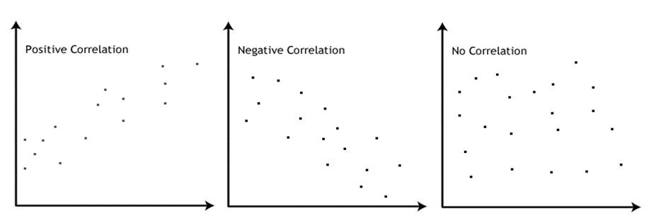

<!-- Parametric & Non-Parametric -->
### Parametric & Non-Parametric

To measure the “degree of association” between:

- **2 continuous** variables (**normally** distributed).
--> Pearson’s correlation coefficient
- **2 continuous** variables (**non normally** distributed).
--> Spearman’s rank
- **2 categorical** variables (**ordinal**).           
--> Kendall’s Tau

::: {.callout-warning title="Reminder"}
Normality of variables is tested using the Shapiro-Wilk test:
Ho:variable normally distributed
:::

<!-- Correlation-coefficient$r$-->
### Correlation-coefficient r

The **Pearson’s correlation coefficient** is defined as:

$$r = \frac{\sum (x - \bar{x})(y - \bar{y})}{\sqrt{\sum (x - \bar{x})^2 \sum (y - \bar{y})^2}}$$

It describes **how $Y$ varies with $X$** (numerator):
$-1 \leq r \leq 1$
$r = -1$   # 100% negative correlation
$r = 1$     # 100% positive correlation

<!-- Interpreting $r$-->
### Interpreting $r$

| Value | Interpretation |
|---|---|
| $r = 0$ | no relationship |
| $\lvert r \rvert = 1$ | perfect linear relationship |
| $\lvert r \rvert < 0.3$ | weak relationship |
| $0.3 \leq \lvert r \rvert \leq 0.7$ | moderate relationship |
| $\lvert r \rvert > 0.7$ | strong relationship |

The **P-value** assigned to $r$ tells us how likely $r$ is right (i.e., confidence in our statement).

<!-- Coefficient of determination $r^2$ -->
### Coefficient of determination r^2

Pearson’s $r$ can be squared, $r^2$, to derive a **coefficient of determination**.

It explains the portion of variability in one of the variables that can be accounted for by the variability in the second one.

Example: Correlation between 2 variables $X$ and $Y$

Pearson’s coefficient: $r$ = -0.7 --> $r^2$ = 0.49

49% of the variability in variable $X$ is determined by the variability of
variable $Y$.

<!-- Visualization -->
### Visualization of Relation between two variables

Scatter-plot

- Displays the relationship between **2 continuous variables**.
- Each point represents the paired value of the variables for each
individual.
- Useful in the early stage of analysis when exploring data and
determining if a linear regression analysis is appropriate.

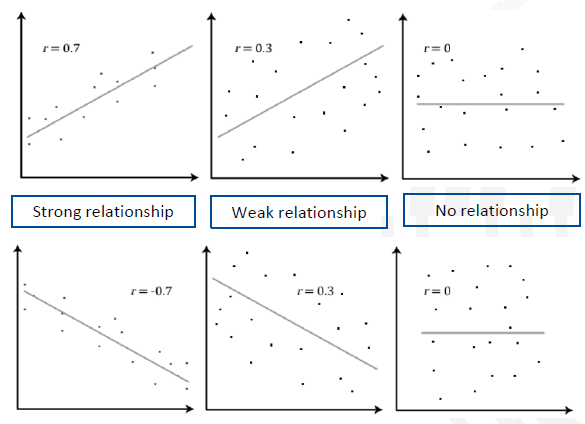

<!-- Exercise 1 -->
## Exercise 1 Are age and resting systolic blood pressure (SBP) correlated?

SBP and Age

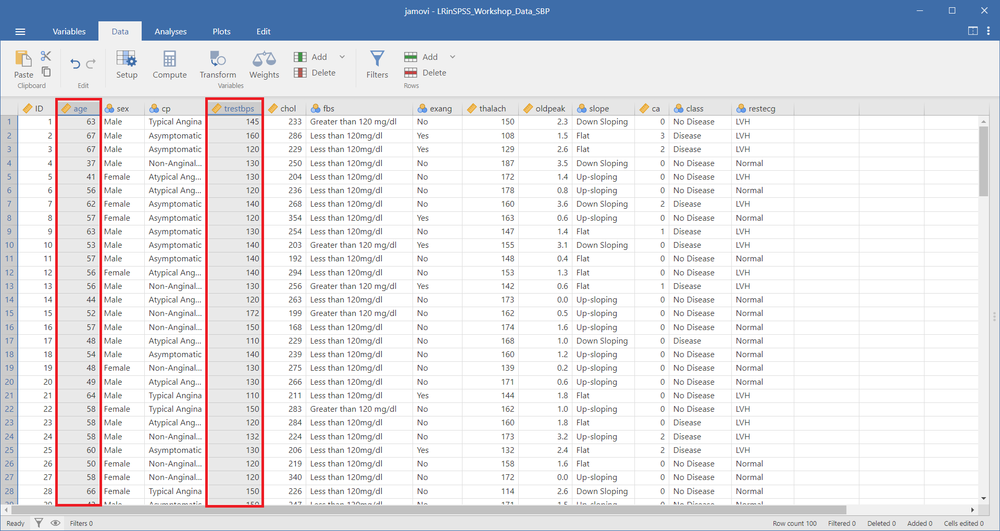

### Visualisation with scatter plots

1. From the top menu, select **Plots > Scatter Plot**.

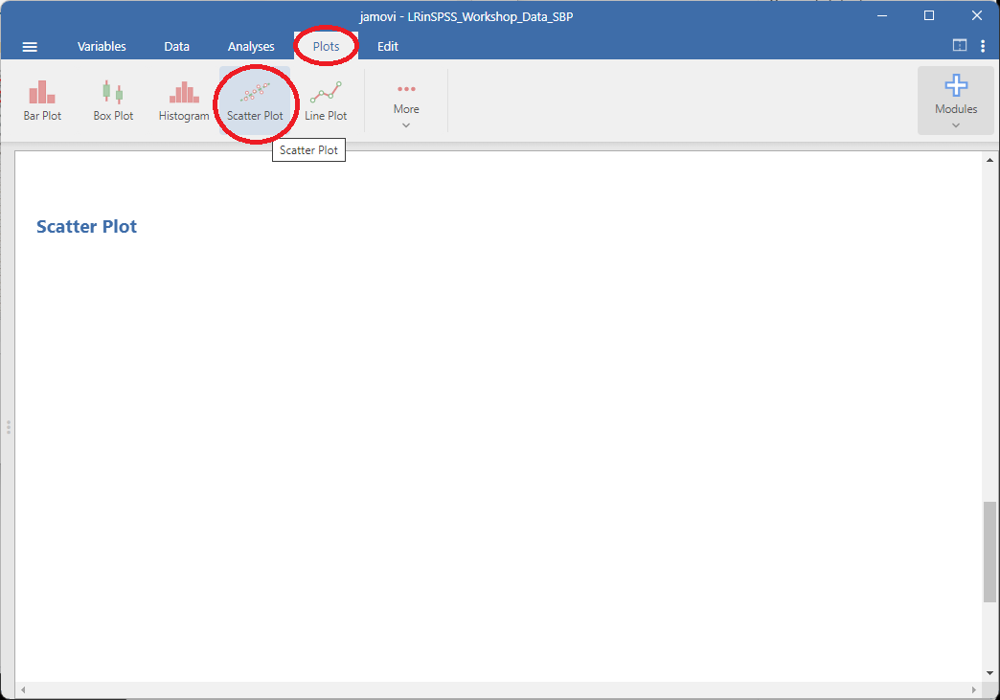

2. Move `age` into X-axis and `trestbps` to Y-axis produce a basic Scatter Plot.

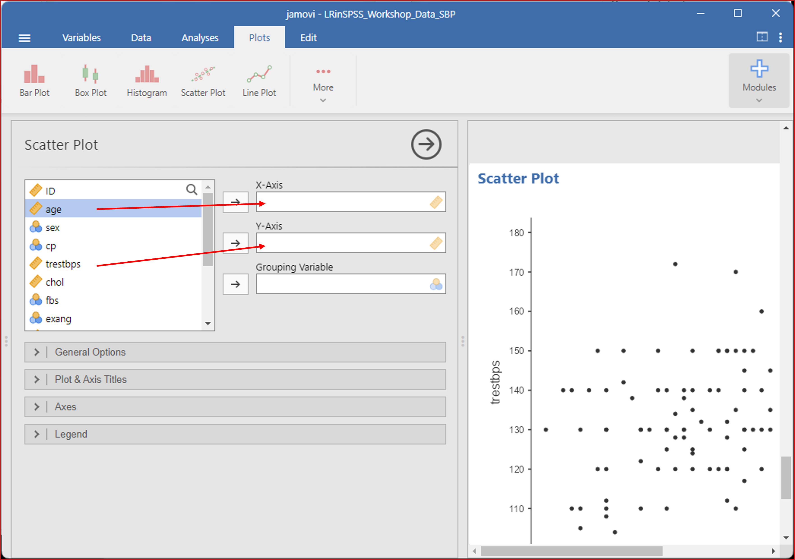

3. Under **General Options** check the box to **Show line**.

- Choose **Linear** for the Method
- Choose with or without Confidence interval

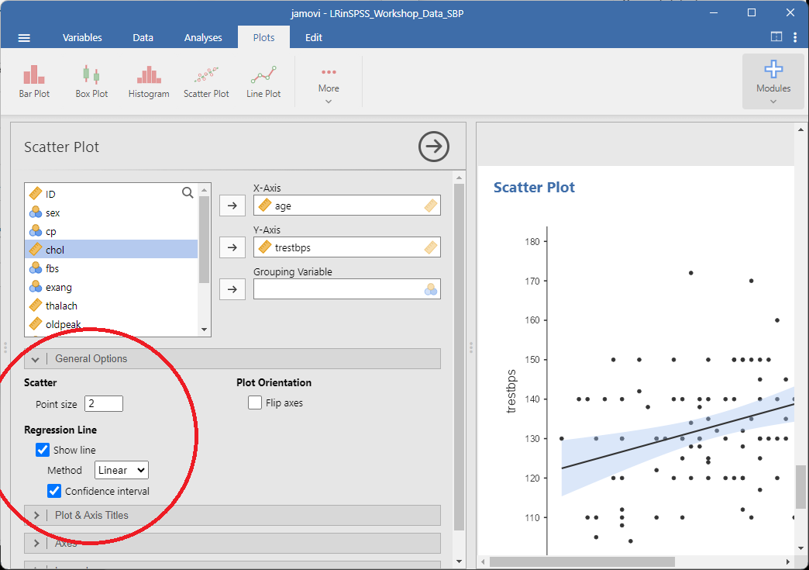

<!-- Normality -->
## Normality Check - Shapiro-Wilk test

Checking distribution of variables: Shapiro-Wilk test for Normality.

1. Select **Analyses > Exploration > Descriptives**.
2. Move `age` and `trestbps` into **Variables**.
3. Under **Statistics**, select **Shapiro-Wilk test**.
4. Under **Plots**, select **Histogram** and **Q-Q plot**.

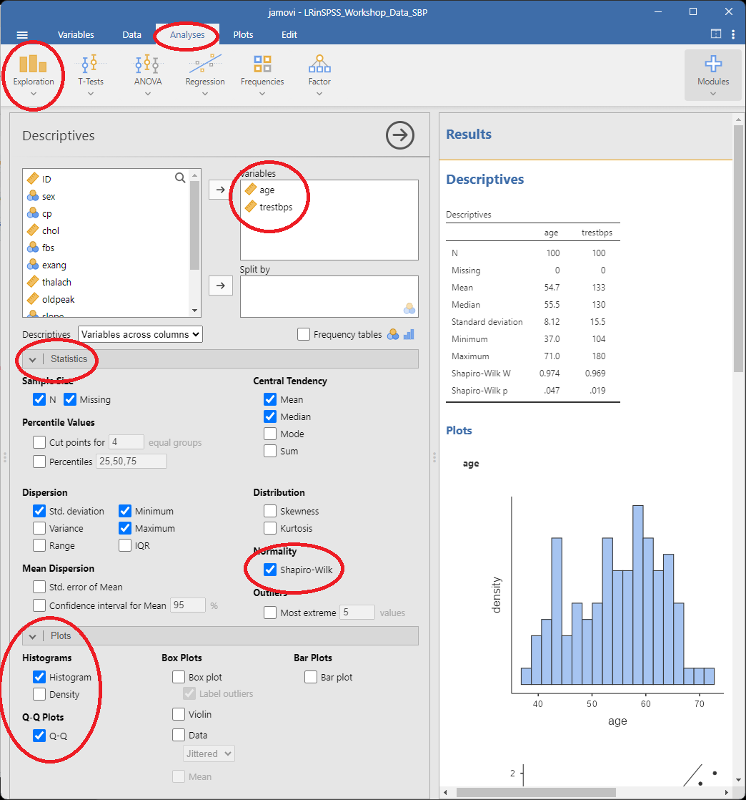
 
The **Results** panel will display a **Descriptives** table, histogram, and normality plots (Normal Q-Q plots) for each of the variables selected.

Do they look normally distributed?
 
::: {layout-ncol=2}

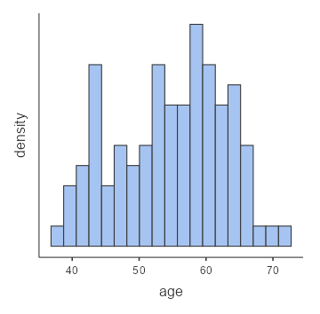

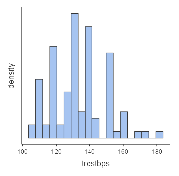

:::

::: {.callout-warning title="Recommendation"}
We highly recommend that you always plot your variables and their
relationships as well summarize them in statistical tables before
conducting a statistical test.

This gives you a reference point and helps identify if you make an error in the statistical test.

For brevity, we will not be doing this for every example in this workshop.
:::

<!-- Descriptives -->
## Descriptives table

The results of the Shapiro-Wilk test are presented in the **Descriptives** table in the **Results** panel.

  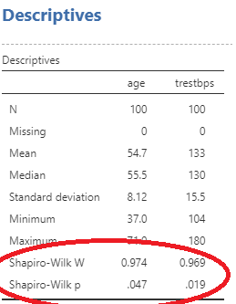
  
Both variables have a p-value of $p < 0.05$. 

Therefore we must use Spearman’s test.                         

<!--Spearman -->
## Spearman's

1. Select **Analyses > Regression > Correlation Matrix**.
2. Move `age` and `trestbps` into **Variables**.
3. Under **Correlation Coefficients**, check **Spearman**.

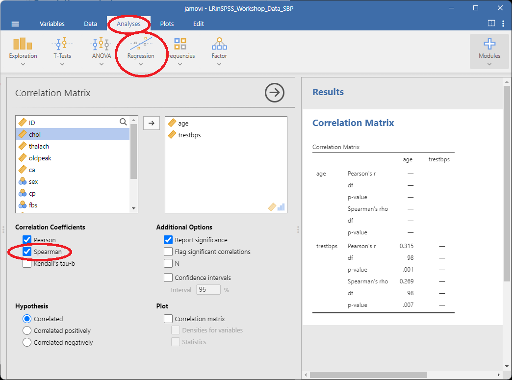

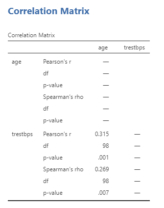

Interpretation: Spearman’s correlation is used to determine the
relationship between an individual’s age and their resting SBP.

There is a weak positive correlation between age and resting SBP
($r=0.269$) and the correlation is significantly different from 0
($p = 0.007$).

<!-- Save -->
## Save the analysis

jamovi keeps the data, analyses and results together in a single `.omv` file. Saving the file allows you to reopen the analysis later with the results and analysis settings intact.

Let’s now save this file as well.

1. Open the File menu **(☰)** and select **Save As**.
2. Select **Browse** and navigate to the `Analysis` folder.
3. Enter a name for the file.
4. **Save** the file as a jamovi (.omv) file.

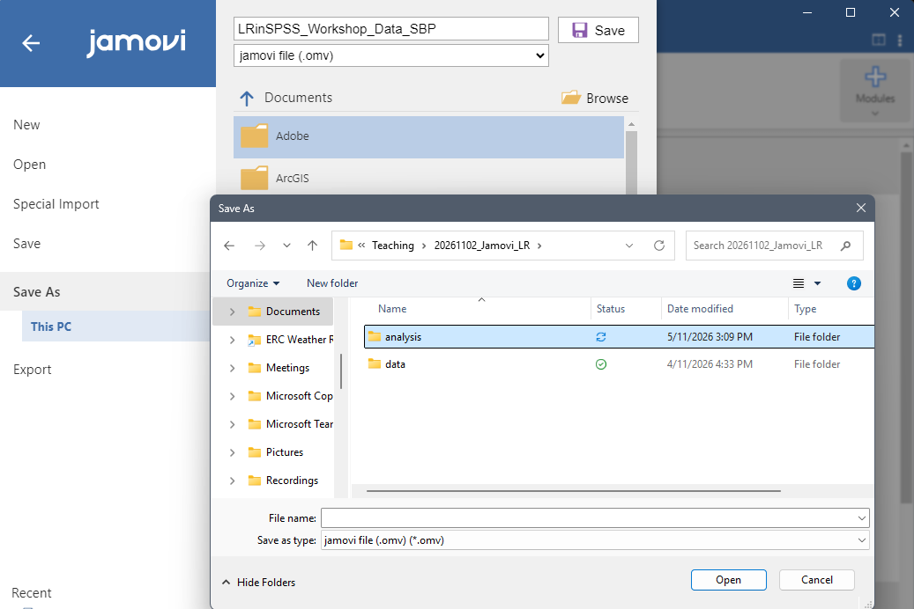

<!-- Exercise 2 - Visualisation --->
## Exercise 2 Is Systolic Blood Pressure associated with other continuous variables of interest?

Visualisation with matrix of scatter plots.

1. Select **Analyses > Correlation > Correlation Matrix**.
2. Move `age`, `chol`, `oldpeak`, `thalach` and `trestbps` into **Variables**.
3. Under **Plots**, check **Correlation Matrix**.

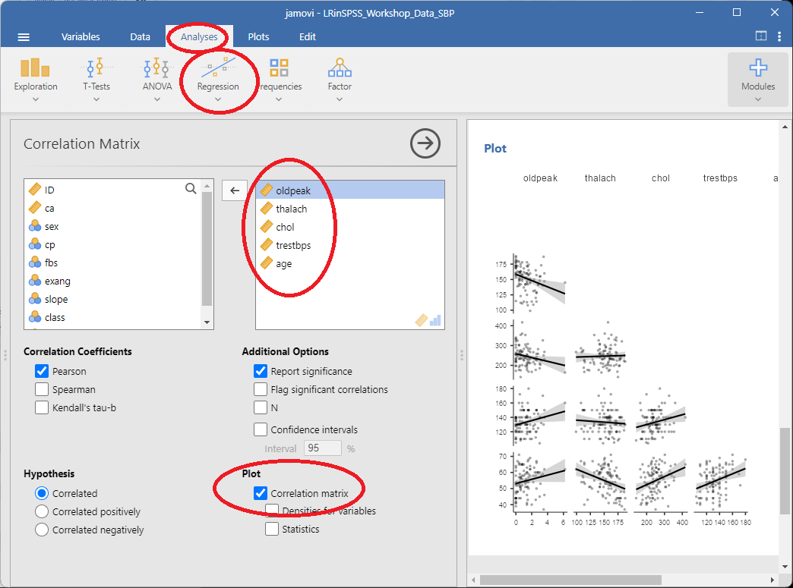

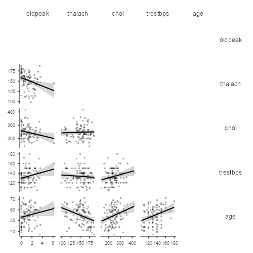

<!-- Exercise 2 - Correlation analyses -->
## Exercise 2 Is Systolic Blood Pressure associated with other continuous variables of interest?

Correlation analysis of multiple variables.

1. Select **Analyses > Correlation > Correlation Matrix**.
2. Move `age`, `chol`, `oldpeak`, `thalach` and `trestbps` into **Variables**.
3. Under **Correlation Coefficients**,uncheck **Pearson** and check **Spearman**.

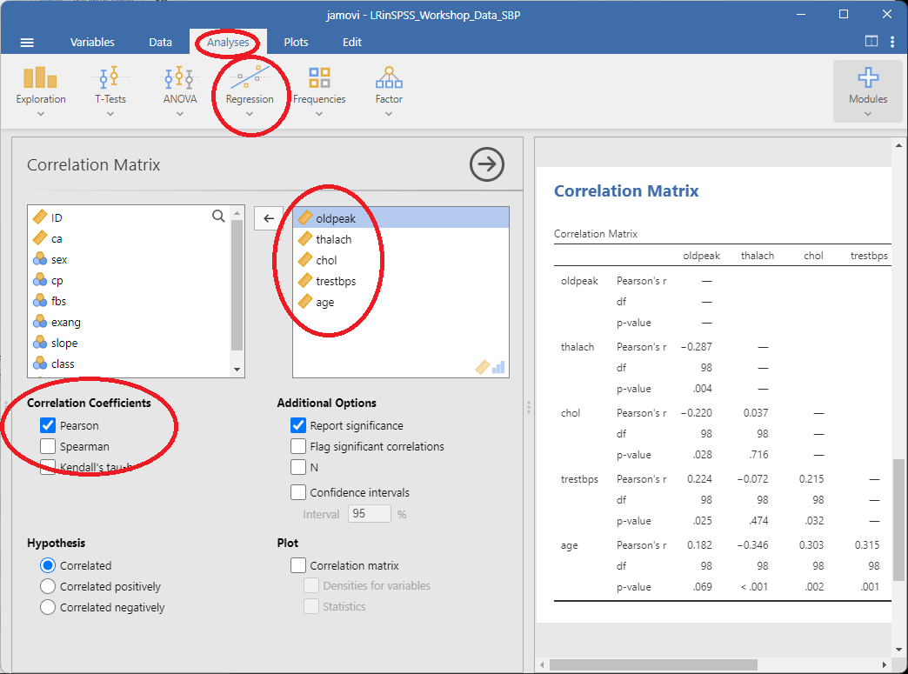

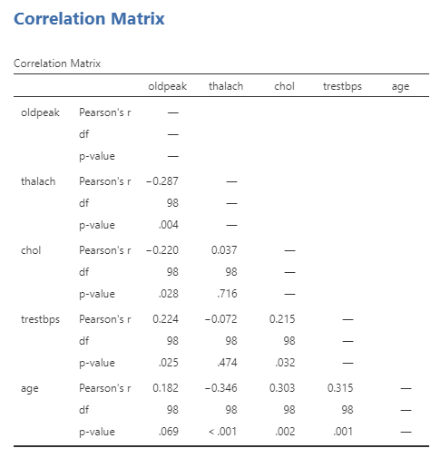

<!-- Break -->
## Break for Morning Tea

 

<!-- overview -->
## Overview

Part 1: Correlation

1. Pearson’s correlation coefficient
2. Spearman’s correlation coefficient

**Part 2: Simple Linear Regression**

1. **Least squares estimation**
2. **Hypothesis testing**
3. **Example**

Part 3: Multiple Linear Regression
1. Assumptions
2. Example

<!-- Linear Regression -->
## Introduction - Linear Regression

::: {layout-ncol=2}

:::

<!-- Simple Linear Regression -->
## Introduction - Simple Linear Regression

In correlation, the two variables are treated as equals.

In regression, one variable is considered as:

- **Independent variable $X$** (predictor)
- **Dependent variable $Y$** (outcome)

### When to use regression analysis?

Regression analysis is used to describe the relationship between:

A single outcome variable: $y$, and
One or more predictor variables: $x_1, x_2, \ldots, x_k$

- If $k = 1$ : Simple linear regression
- If $k > 1$ : Multiple linear regression

Predicting $Y$ based on a given value of $X$

$X$ = Independent / Predictor variable (continuous, categorical or nominal)
$Y$ = Dependent / Outcome variable (continuous)    

$$
y = a + bx + e
$$

where:

- $y$ = the observed value of the outcome variable
- $a$ = the intercept
- $b$ = the regression coefficient (slope)
- $x$ = the value of the predictor variable
- $e$ = the error or residual

Test of significance: $b$ is significantly different from zero

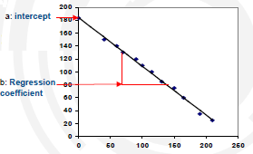

Problem: To draw a straight line through the points that best
explains the relationship.

::: {layout-ncol=2}

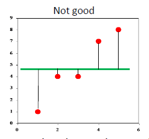
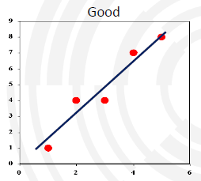

:::

Line can then be used to predict $Y$ from $X$.

<!-- Least Squares Estimation -->
## Least Squares Estimation

A good line is the one that minimises the **sum of squared
differences** between the points and the line.

The smaller the sum of squared differences, the better the fit of
the line to the data.

__Sum of squared differences:__
Green line:
(1-4.5)^2  +(4-4.5)^2 + (4-4.5)^2 + (7-4.5)^2  +(8-4.5)^2 = 31.25

Blue line:
(1-2)^2 + (4-3)^2 + (4-4.5)^2 + (7-6)^2 + (8-7.5)^2 = 3.5

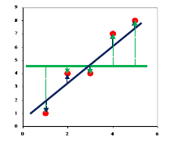

<!--Background -->
## Least Squares Estimation (Background Information)

Using calculus, we get:

$$
b =
\frac{\sum (x_i - \bar{x})(y_i - \bar{y})}
     {\sum (x_i - \bar{x})^2}
=
\frac{\operatorname{Cov}(x,y)}
     {\operatorname{Var}(x)}
$$

$$
a = \bar{y} - b\bar{x}
$$

Coefficient $b$ is related to the correlation coefficient $r$.

If $X$ and $Y$ are positively correlated, then slope `b` is positive.

$$
r = b\frac{SD_x}{SD_y}
$$

<!-- Hypothesis Tests -->
## Regression Hypothesis Tests

Is the slope significantly different from 0?
|  |  |
|---|---|
| Hypothesis | H0: b = 0 (no relationship) |
|  | H1: b ≠ 0 (linear relationship) |

| Test of significance | T = b/SE(b) |
| Result | p-value significant or not |
| Conclusion | the slope is different from 0 |
|  | significant linear relationship |

<!-- Original slide 62 -->
## Original slide 62

Residuals
- The residual for observation i (𝑒𝑒𝑖𝑖 )- is the difference between its
observed and predicted value
𝑒𝑒𝑖𝑖 = 𝑌𝑌𝑖𝑖 − 𝑌𝑌�𝑖𝑖

- Check the assumptions of regression by examining the residuals
- Examine for linearity assumption
- Examine for constant variance for all levels of $X$ (homoscedasticity)
- Evaluate normal distribution assumption
- Evaluate independence assumption
- Check the presence of outliers
64

<!-- Original slide 63 -->
## Original slide 63

Coefficient of determination (R2)
R2
- Represents the proportion of the dependent variable explained by
the independent variable.
- Indicates how well the model fits the data.
Adjusted R2
- Used for estimating explained variance in a population (≠sample).
- Used when sample size is small and when results have to be
generalized.

65

<!-- Original slide 64 -->
## Original slide 64

Linear Regression
Example: Effect of cigarette consumption on Coronary Heart Disease

Cig = Cigarette                                  CHD = Coronary
consumption                                      Heart Disease
Example from Landwehr & Watkins (1987) and cited in Howell (2004)
66

<!-- Original slide 65 -->
## Original slide 65

Simple Linear Regression
Example: Effect of cigarette consumption on Coronary Heart Disease
Research question: How fast does CHD mortality rise depending on
smoking?

CHD ($Y$ variable) = CHD mortality rate (deaths per 10,000 per year due
to CHD)
Cig ($X$) = average number of cigarettes per adult per day

67

<!-- Original slide 66 -->
## Original slide 66

Simple Linear Regression
Example: Effect of cigarette consumption on Coronary Heart Disease
Scatter Plot with the line that best fits:

68

<!-- Original slide 67 -->
## Original slide 67

Simple Linear Regression
Example: Effect of cigarette consumption on Coronary Heart Disease

Linear regression equation:

Predicted        Intercept:       Slope:
values           level of $Y$      rate of increase/
of $Y$          when $X$ is 0      decrease of $Y$ predicted
for each unit increase
of $X$ 
69

<!-- Original slide 68 -->
## Original slide 68

Simple Linear Regression
Example: Effect of cigarette consumption on Coronary Heart Disease

Linear regression equation:

𝐶𝐶𝐶𝐶𝐶𝐶𝑝𝑝𝑝𝑝𝑝𝑝𝑝𝑝 = 𝑎𝑎 + 𝑏𝑏 ∗ 𝐶𝐶𝐶𝐶𝐶𝐶. 𝑐𝑐𝑐𝑐𝑐𝑐𝑐𝑐
Predicted        Intercept:       Slope:
values         level of CHD      rate of increase of CHD
Of CHD         when 0 cig is     for each unit increase
consumed         of Cig consumption

70

<!-- Original slide 69 -->
## Original slide 69

Simple Linear Regression
Example: Effect of cigarette consumption on Coronary Heart Disease

Regression coefficients:

P-value < 0.05  b is significantly different from 0
There is a significant linear relationship between Cig consumption
and CHD mortality                                                       71

<!-- Original slide 70 -->
## Original slide 70

Simple Linear Regression
Example: Effect of cigarette consumption on Coronary Heart Disease

Regression model:

𝑌𝑌� = 𝑎𝑎 + 𝑏𝑏𝑏𝑏 = 2.37 + 2.04𝑋𝑋

 “CHD mortality” is equal to 2.37 when 0 cigarette is consumed.

 “CHD mortality” is increased by 2.04 units per increase of “Cig
consumption” units.

72

<!-- Original slide 71 -->
## Original slide 71

Simple Linear Regression
Example: Effect of cigarette consumption on Coronary Heart Disease

Prediction:
What is the CHD mortality when cigarette consumption is 6?

𝑌𝑌� = 𝑎𝑎 + 𝑏𝑏𝑏𝑏 = 2.37 + 2.04𝑋𝑋

We predict 14.61/10000 people will die of CHD per annum in a
country with an average consumption of 6 cigarettes per adult.

73

<!-- Original slide 72 -->
## Original slide 72

Simple Linear Regression
Example: Effect of cigarette consumption on Coronary Heart Disease

Accuracy of prediction (residuals):

Residuals are the vertical
distance between actual
and predicted values

74

<!-- Original slide 73 -->
## Original slide 73

Simple Linear Regression
Example: Effect of cigarette consumption on Coronary Heart Disease

Accuracy of prediction (residuals):

X = 6 cigarettes per adult per day

Prediction: 14.61 deaths / 10,000

What they actually have:
23 deaths / 10,000

Residual error for this case:
23-14.61 = 8.39
75

<!-- Original slide 74 -->
## Original slide 74

Simple Linear Regression
Example: Effect of cigarette consumption on Coronary Heart Disease

Explained variance:

𝑟𝑟 = 0.71
𝑟𝑟 2 = 0.712 = 0.51

Conclusion:
Almost 50% in variability of incidence of CHD mortality is associated
with variability in smoking rates.

76

<!-- Original slide 75 -->
## Original slide 75

Exercise 3

Is Systolic Blood Pressure (SBP)
associated with Age?

77

<!-- Original slide 76 -->
## Original slide 76

Exercise 3
Visualisation with scatter plot
The scatter plot allows one to check if there is a linear relationship
(Obtained in Exercise 1).

78

<!-- Original slide 77 -->
## Original slide 77

Exercise 3
Visualisation with scatter plot
The scatter plot allows one to check if there is a linear relationship
(Obtained in Exercise 1).

b: Regression
coefficient

a: intercept

79

<!-- Original slide 78 -->
## Original slide 78

Exercise 3
Estimation of parameters
1 Click Analyze > Regression > Linear in the top menu.

80

<!-- Original slide 79 -->
## Original slide 79

Exercise 3
Estimation of parameters
2 This screen appears.

81

<!-- Original slide 80 -->
## Original slide 80

Exercise 3
Estimation of parameters
3 Transfer the variable
into the Dependent
box and the variable
into the Independent(s):
box by selecting them and
clicking .

4 Click on Statistics…

82

<!-- Original slide 81 -->
## Original slide 81

Exercise 3
Estimation of parameters
5 Tick the boxes Descriptives
and Confidence intervals
(leave the default Level(%):
95) untouched.

6 Click on Continue, then OK.

83

<!-- Original slide 82 -->
## Original slide 82

Exercise 3
Estimation of parameters: Output

Output: Model Summary
- R: Pearson Correlation Coefficient between Age and Systolic Blood
Pressure (SP) of 0.315.
- Adjusted R square: Coefficient of determination of 0.09, meaning
that Age accounts for 9% of the variation of SBP.

84

<!-- Original slide 83 -->
## Original slide 83

Exercise 3
Estimation of parameters: Output

Output: ANOVA table
- Sig.: Significance level associated to F-ratio. It is < 0.05. Meaning
that the regression model predicts SBP significantly well.

85

<!-- Original slide 84 -->
## Original slide 84

Exercise 3
Estimation of parameters: Output

Coefficients:
- Unstandardized B: Estimations of model parameters – Intersect(a)
and Slope Coefficient (b).
Age has a significant effect on SBP (Sig. < 0.05). For one year
increase in age there was 0.604 unit increase in SBP level.
- 95% C.I. for B: SBP level increases by between 0.24 and 0.97 mmHg
by one year increase in age.

86

<!-- Original slide 85 -->
## Original slide 85

Exercise 3
Confidence and prediction
- Confidence intervals tell how well you have determined the
estimate parameter. The standard error for a CI takes into account
the uncertainty due to sampling.
- Prediction intervals tell where you can expect to see the next data
point sampled (give a range for $y$ itself). The standard error for a PI
takes into account the uncertainty due to sampling + the variability
of the individuals around the predicted mean.
- Both intervals will be centered around the same value, but the
standard errors will be different. A prediction interval is always
wider than a confidence interval.
87

<!-- Original slide 86 -->
## Original slide 86

Exercise 3
Confidence and prediction
1 Click Analyze > Regression >

Linear in the top menu.

2 Check that the Linear
Regression window hasn’t
changed.

3 Click on Save…

88

<!-- Original slide 87 -->
## Original slide 87

Exercise 3
Confidence and prediction
4 Tick the boxes Predicted
Values: Unstandardized;
Prediction Intervals: Mean
and Individual; and Residuals:
Unstandardized.

5 Click on Continue, then OK.

89

<!-- Original slide 88 -->
## Original slide 88

Exercise 3
Confidence and prediction
6 Click on the Data View tab.

90

<!-- Original slide 89 -->
## Original slide 89

Exercise 3
Confidence and prediction
6 Click on the Data View tab.

New variables were generated:
: Predicted values of SBP for each value of Age.
: Estimated residuals
: Lower bound of the 95% Confidence Interval.
: Upper bound of the 95% Confidence Interval.
: Lower bound of the 95% Prediction Interval.
: Upper bound of the 95% Prediction Interval.

91

<!-- Original slide 90 -->
## Original slide 90

Exercise 3
What can go wrong?
Violations:
- In the linear regression model:
- Nonlinearity (e.g. quadratic relationship, higher order terms).
- Level of measurement incorrect
- Sample size too small
- In the residual assumptions:
- Non-normal distribution.
- Non-constant variances.
- Dependency.
- Outliers.
92

<!-- Original slide 91 -->
## Original slide 91

Exercise 3
What can go wrong?
Checks:
- Level of measurement                       • Constant variance of residuals
- Check outcome and predictor            – Check residuals vs. fitted values plot
variable type
- Observations are independent
- Sample size                                   – Check residuals vs. fitted values plot
- Sample is at least 10 or 20 subjects
- No outliers
- Linearity between outcome and                 – Check residuals vs. fitted values plot
predictor:
- Plot residuals vs. predictor variable
- Normality of residuals
- Check residuals normal probability
plot.
93

<!-- Original slide 92 -->
## Original slide 92

Exercise 3
What can go wrong?
Checks:                                      Level of measurement:
- Level of measurement                          • Constant
- Dependent   variable: Continuous.
variance    of residuals
- Check outcome and predictor          Independent
- Checkvariables:  Continuous
residuals vs.             orplot
fitted values
variable type                          dichotomous.
- Observations are independent
- Sample size                                      – Check residuals vs. fitted values plot
- Sample is at least 10 or 20 subjects
- No outliers
- Linearity between outcome and                    – Check residuals vs. fitted values plot
predictor:
- Plot residuals vs. predictor variable
- Normality of residuals
- Check residuals normal probability
plot
94

<!-- Original slide 93 -->
## Original slide 93

Exercise 3
What can go wrong?
Checks:                                   Sample size:
- Level of measurement                    # of•subjects (n) Should
Constant          be at
variance    ofleast  10 or
residuals
- Check outcome and predictor          20 times–greater
Checkthan   # independent
residuals vs. fitted values plot
variable type                       variables (m).
n =
- 100Observations are independent
- Sample size
m = 1 – Check residuals vs. fitted values plot
- Sample is at least 10 or 20 subjects  n>>m
- No outliers
- Linearity between outcome and                       –   Check residuals vs. fitted values plot
predictor:
- Plot residuals vs. predictor variable
- Normality of residuals
- Check residuals normal probability
plot
95

<!-- Original slide 94 -->
## Original slide 94

Exercise 3
What can go wrong?
Checks:
- Level of measurement                       • Constant variance of residuals
- Check outcome and predictor            – Check residuals vs. fitted values plot
variable type
- Observations are independent
- Sample size                                   – Check residuals vs. fitted values plot
- Sample is at least 10 or 20 subjects
- No outliers
- Linearity between outcome and                 – Check residuals vs. fitted values plot
predictor:
- Plot residuals vs. predictor variable
- Normality of residuals
- Check residuals normal probability
plot
96

<!-- Original slide 95 -->
## Original slide 95

Exercise 3
Linearity between outcome and predictors
1 Click Graphs > Chart Builder … in the top menu.

97

<!-- Original slide 96 -->
## Original slide 96

Exercise 3
Linearity between outcome and predictors
2 Click OK.

98

<!-- Original slide 97 -->
## Original slide 97

Exercise 3
Linearity between outcome and predictors
3 This screen appears.

4 Click on Reset.

99

<!-- Original slide 98 -->
## Original slide 98

Exercise 3
Linearity between outcome and predictors
5 Choose option
Scatter/Dot in Gallery.

6 Drag-and-Drop the icon
into the Chart Preview
Area.

100

<!-- Original slide 99 -->
## Original slide 99

Exercise 3
Linearity between outcome and predictors
7 Drag-and-drop      in
the X-axis box and
in the Y-axis box.

8 Tick the Linear Fit Lines:
Total Box

101

<!-- Original slide 100 -->
## Original slide 100

Exercise 3
Linearity between outcome and predictors
9 Click OK.

- A well-behaved
“residuals vs. predictor
plot” will bounce
randomly and form a
roughly horizontal band
around the residual = 0
line

102

<!-- Original slide 101 -->
## Original slide 101

Exercise 3
Linearity between outcome and predictors
9 Click OK.

- A well-behaved
“residuals vs. predictor
plot” will bounce
randomly and form a
roughly horizontal band
around the residual = 0
line

103

<!-- Original slide 102 -->
## Original slide 102

Exercise 3
Linearity between outcome and predictors

$Y$                                   Y

x                            x

residuals                             residuals
x                            x

Not Linear                          Linear
104

<!-- Original slide 103 -->
## Original slide 103

Exercise 3
What can go wrong?
Checks:
- Level of measurement                       • Constant variance of residuals
- Check outcome and predictor            – Check residuals vs. fitted values plot
variable type
- Observations are independent
- Sample size                                   – Check residuals vs. fitted values plot
- Sample is at least 10 or 20 subjects
- No outliers
- Linearity between outcome and                 – Check residuals vs. fitted values plot
predictor:
- Plot residuals vs. predictor variable
- Normality of residuals
- Check residuals normal probability
plot.
105

<!-- Original slide 104 -->
## Original slide 104

Exercise 3
Normality of residuals
1 Click Analyze > Regression

> Linear in the top menu.

2 Check that the Linear
Regression window hasn’t
Changed.

3 Click Plots…

106

<!-- Original slide 105 -->
## Original slide 105

Exercise 3
Normality of residuals
4 Tick the Normal Probability
plot box.

5 Click on Continue, then OK.

107

<!-- Original slide 106 -->
## Original slide 106

Exercise 3
Normality of residuals

- A well-behaved
“Normal P-P plot”
roughly lines the points
along the diagonal line.
This suggests that the
residuals are normally
distributed.

108

<!-- Original slide 107 -->
## Original slide 107

Exercise 3
What can go wrong?
Checks:
- Level of measurement                       • Constant variance of residuals
- Check outcome and predictor            – Check residuals vs. fitted values plot
variable type
- Observations are independent
- Sample size                                   – Check residuals vs. fitted values plot
- Sample is at least 10 or 20 subjects
- No outliers
- Linearity between outcome and                 – Check residuals vs. fitted values plot
predictor:
- Plot residuals vs. predictor variable
- Normality of residuals
- Check residuals normal probability
plot
109

<!-- Original slide 108 -->
## Original slide 108

Exercise 3
Residual analysis for Homoscedasticity, Independence and outliers
1 Click Analyze > Regression

> Linear in the top menu.

2 Check that the Linear
Regression window hasn’t
Changed.

3 Click Plots…

110

<!-- Original slide 109 -->
## Original slide 109

Exercise 3
Residual analysis for Homoscedasticity, Independence and outliers
4 Transfer the variables
to the Y: box and the
variable       to the $X$ :
box.

5 Click on Continue, then OK.

111

<!-- Original slide 110 -->
## Original slide 110

Exercise 3
Residual analysis for Homoscedasticity, Independence and outliers
- A well-behaved
“residuals vs. fitted values
plot” roughly form a
“horizontal band” around
the residual = 0 line. This
suggests that the variances
of the error terms are
equal, and observations are
independent. No one
residual stands out from
the basic random pattern
of residuals (no outliers).
112

<!-- Original slide 111 -->
## Original slide 111

Exercise 3
Residual analysis for Homoscedasticity, Independence and outliers
- A well-behaved
“residuals vs. fitted values
plot” roughly form a
“horizontal band” around
the residual = 0 line. This
suggests that the variances
of the error terms are
equal, and observations are
independent. No one
residual stands out from
the basic random pattern
of residuals (no outliers).
113

<!-- Original slide 112 -->
## Original slide 112

Exercise 3
Residual analysis for Homoscedasticity

$Y$                                     Y

x                                   x

residuals                                   residuals
x                                   x

Non-constant variance                   Constant variance
114

<!-- Original slide 113 -->
## Original slide 113

Exercise 3
Residual analysis for Independence of observations

residuals
X

residuals
X

residuals
X

Not Independent                      Independent
115

<!-- Original slide 114 -->
## Original slide 114

Exercise 3
No extreme outliers
Cases with extreme values that differ greatly from the rest of your
sample.

116

<!-- Original slide 115 -->
## Original slide 115

Exercise 3
No extreme outliers
Even a few outliers can dramatically change estimates of the slope (b).
4
Extreme case that
pulls regression
2                             line up

-4       -2       0        2         4

-2

-4                                             117

<!-- Original slide 116 -->
## Original slide 116

Exercise 3
No extreme outliers

4

2

-4   -2     0         2         4
Regression line
-2                   with extreme case
removed from
sample
-4                                       118

<!-- Original slide 117 -->
## Original slide 117

Exercise 3
No extreme outliers
Outliers can result from:
- Errors in coding or data entry (→ rectify).
- Impossible values in real life (→ exclude).
- Or sometimes they reflect important “real” variation (→ include,
run the analysis both with and without it).

If you see no reason why your outliers are erroneous measurements
 there is no truly objective way to remove them.

119

<!-- Original slide 118 -->
## Original slide 118

Exercise 3
What can go wrong?
Checks:
- Level of measurement                        Constant variance of residuals
- Check outcome and predictor            – Check residuals vs. fitted values plot
variable type
- Observations are independent
- Sample size                                   – Check residuals vs. fitted values plot
- Sample is at least 10 or 20 subjects
- No outliers
- Linearity between outcome and                 – Check residuals vs. fitted values plot
predictor:
- Plot residuals vs. predictor variable
Conclusion:
- Normality of residuals                      All assumptions of the linear
- Check residuals normal probability        regression model are met.
plot
120

<!-- Original slide 119 -->
## Original slide 119

<!-- Original slide 120 -->
## Original slide 120

Exercise 4

Is Systolic Blood Pressure (SBP)
associated with Gender?

122

<!-- Original slide 121 -->
## Original slide 121

Exercise 4
Visualisation with box plots
1 Click Graphs > Chart Builder … in the top menu.

123

<!-- Original slide 122 -->
## Original slide 122

Exercise 4
Visualisation with box plots
2 Click OK.

124

<!-- Original slide 123 -->
## Original slide 123

Exercise 4
Visualisation with box plots
3 This screen appears.

4 Click on Reset.

125

<!-- Original slide 124 -->
## Original slide 124

Exercise 4
Visualisation with box plots
5 Choose option Boxplot
in Gallery.

6 Drag-and-Drop the icon
into the Chart Preview
Area.

126

<!-- Original slide 125 -->
## Original slide 125

Exercise 4
Visualisation with box plots
7 Drag-and-drop        in
the X-axis box and
in the Y-axis
box.

127

<!-- Original slide 126 -->
## Original slide 126

Exercise 4
Visualisation with box plots
8 Click OK.

128

<!-- Original slide 127 -->
## Original slide 127

Exercise 4
Estimation of parameters
1 Click Analyze > Regression > Linear in the top menu.

129

<!-- Original slide 128 -->
## Original slide 128

Exercise 4
Estimation of parameters
2 This screen appears.

3 Click on Reset (if boxes not
blank).

130

<!-- Original slide 129 -->
## Original slide 129

Exercise 4
Estimation of parameters
4 Transfer the variable
into the Dependent box and
the variable     into the
Independent(s): box by
selecting them and clicking

5 Click on Statistics…

131

<!-- Original slide 130 -->
## Original slide 130

Exercise 4
Estimation of parameters
6 Tick the boxes Descriptives
and Confidence intervals
(leave the default Level(%):
95) untouched.

7 Click on Continue, then OK.

132

<!-- Original slide 131 -->
## Original slide 131

Exercise 4
Estimation of parameters: Output

Model Summary:
- R square: Coefficient of determination of
0.012, meaning that Gender accounts for
1.2% of the variation of SBP.

ANOVA table :
- Sig.: Significance level is > 0.05.
Meaning that the regression
model does not predict SBP
significantly well.
133

<!-- Original slide 132 -->
## Original slide 132

Exercise 4
Estimation of parameters: Output

Coefficients:
- Unstandard. B: Gender has an insignificant effect on SBP (Sig. >
0.05). B = -5.068 is the average difference in SBP between the
reference group (Females) and the comparison group (Males).
- 95% C.I.: There was no difference in SBP between males and
females which was confirmed by C.I. containing the value 0.

134

<!-- Original slide 133 -->
## Original slide 133

Break for Lunch

135

<!-- Original slide 134 -->
## Original slide 134

Overview
Part 1: Correlation
1. Pearson’s correlation coefficient
2. Spearman’s correlation coefficient
Part 2: Simple Linear Regression
1. Least squares estimation
2. Hypothesis testing
3. Example
Part 3: Multiple Linear Regression
1. Assumptions
2. Example
136

<!-- Original slide 135 -->
## Original slide 135

Multiple Linear Regression
- Extension of simple linear regression to more than one
(continuous/ordinal) independent variables.

- Simple Linear Regression:
$X$                       Y
- Multiple Linear Regression:
$X1$
$X2$
$X3$                      Y
$X4$

<!-- Original slide 136 -->
## Original slide 136

Multiple Linear Regression
Example
Cigarettes and coronary heart disease
- According to the results of the linear regression:
50% of the variance in CHD mortality could be explained by cigarette
consumption.

- What about the other 50%? Maybe exercise or cholesterol?

- Variables:
Cig
Cig (X1) = # of cigarettes/day                             CDH
Ex (X2) = # of daily hours of exercise             Ex     mortality
Chol (X3) = rate of cholesterol                    Chol
138

<!-- Original slide 137 -->
## Original slide 137

Multiple Linear Regression
Same way to obtain estimates of the regression coefficients (least
squares), e.g. for $X$ i independent variables:

𝑌𝑌� = 𝑎𝑎 + 𝑏𝑏1 𝑥𝑥1 + 𝑏𝑏2 𝑥𝑥2 + ⋯ + 𝑏𝑏𝑖𝑖 𝑥𝑥𝑖𝑖 + 𝑒𝑒
- a: Y-intercept
- x1 to xi: scores of the independent variables
- Slopes (b1 to bi): regression coefficients
(weighted scores of each independent variable, adjusted for the other
ones in the model)
- e: error (residuals)
139

<!-- Original slide 138 -->
## Original slide 138

Multiple Linear Regression
More than one predictor...

𝑌𝑌� = 𝑎𝑎 + 𝑏𝑏1 𝑥𝑥1 + 𝑏𝑏2 𝑥𝑥2 + ⋯ + 𝑏𝑏𝑖𝑖 𝑥𝑥𝑖𝑖 + 𝑒𝑒

Each regression coefficient is the amount of change in the outcome
variable that would be expected per one-unit change of the predictor,
if all other variables in the model were held constant.

140

<!-- Original slide 139 -->
## Original slide 139

Multiple Linear Regression
Functions of multivariable analysis:

- Control for confounder effects.
- e.g. to adjust for age, add age into the model.
- Test for interactions between predictors.
- Improve prediction.

141

<!-- Original slide 140 -->
## Original slide 140

Multiple Linear Regression
Assumptions
- Level of measurement.
- Sample size.
- Linearity between outcome and predictors.
- Independence of observations.
- Homoscedasticity of residuals.
- Normality of residuals.
- No multicollinearity.
- No extreme outliers.
- No overfitting.
142

<!-- Original slide 141 -->
## Original slide 141

Multiple Linear Regression
Level of Measurement & Sample size
Level of measurement:
- Dependent variable: Continuous.
- Independent variables: Continuous or dichotomous.

Sample size: n = #subjects, m = #independant var.
- Should be at least 10 or 20 times as many observations as there are
independent variables (n>>m) otherwise the estimates of the regression
are unstable.

143

<!-- Original slide 142 -->
## Original slide 142

Multiple Linear Regression
Linearity between outcome and predictors
Linearity between outcome and predictors:
- Look at the plot of residuals vs. predicted values.
- If the residuals are spread randomly around a straight line, this suggests
that the assumption that the relationship is linear is reasonable.

Independence of observations:
- Each observation in the data set corresponds to a different individual.
- Look at the plot of residuals vs. predicted values.
- If the residuals are spread randomly around the residual = 0 line, this
suggests that the assumption of independence of observations is
reasonable.                                                                 144

<!-- Original slide 143 -->
## Original slide 143

Multiple Linear Regression
Homoscedasticity of residuals
Homoscedasticity of residuals
- Look at the plot of residuals vs. predicted values.
- If size of errors proportional to size of predictors, can be due to violation
of linearity and/or independence of errors.
- Solution: log-transformation of the dependent variable.

145

<!-- Original slide 144 -->
## Original slide 144

Multiple Linear Regression
Normality of residuals
Normality of residuals
- Look at the residuals normal probability plot.
- Points should fall close to the diagonal line.
- If not, can be due to variables non-normally distributed, non-linear
relationship, outliers …
- Solution: log-transformation of the variables.

146

<!-- Original slide 145 -->
## Original slide 145

Multiple Linear Regression
No Multicollinearity & Outliers
Multicollinearity
- If two independent variables are closely related (correlation coefficient is
high) it is difficult to estimate their regression coefficients because they
tend to get confused and they will cancel each other out and destroy the
model.
- This difficulty is called collinearity.
- Solution is to exclude one of the highly correlated variables.

Outliers
- Outliers can have a strong influence on the regression estimates.
- Solution depends on the origin of the outlier.
147

<!-- Original slide 146 -->
## Original slide 146

Multiple Linear Regression
No overfitting
In multivariable modeling, you can get highly significant but
meaningless results if you put too many predictors in the model
compared to the number of samples

The model is fit perfectly to the quirks of your particular sample but
has no predictive ability in a new sample.

148

<!-- Original slide 147 -->
## Original slide 147

Multiple Linear Regression
No overfitting
A common approach that controls over fitting by keeping the number
of predictors to a minimum is stepwise multiple regression:

- Start with the one predictor that explains the most predicted
variance (i.e., has the highest correlation coefficient with the
outcome).
- Statistically significant predictors are added to the model one at a
time.
- The process is repeated until no remaining predictor has a
statistically significant correlation with the outcome.
149

<!-- Original slide 148 -->
## Original slide 148

Multiple Linear Regression
Coefficient of determination (R2)
R2
- Represents the proportion of the dependent variable explained by
combined effects of the independent variables.
- Indicates how well the model fits the data.
Adjusted R2
- Used for estimating explained variance in a population (≠sample).
- Used when sample size is small and when results have to be
generalized.
- Corrects for overparameterization.
150

<!-- Original slide 149 -->
## Original slide 149

Multiple Linear Regression
Example: Effect of ignoring problems and not worrying on psychological stress
Does “ignoring problems” (ind. var 1) and “not worrying” (ind. var 2)
predict “psychological distress” (dep. var)?

Neill (2001)

151

<!-- Original slide 150 -->
## Original slide 150

Multiple Linear Regression
Example: Effect of ignoring problems and not worrying on psychological stress
Study design:
- n = 224 participants (Australian adolescent population).
- Y: Measure of psychological distress (low scores indicated a high
level of psychological distress).
- $X$ 1 : Not Worrying (score based on items).
- $X$ 2 : Ignoring problems (score based on items).

152

<!-- Original slide 151 -->
## Original slide 151

Multiple Linear Regression
Example: Effect of ignoring problems and not worrying on psychological stress
Proposed model:

X1
Not
Worrying
Y
Psychological
X2                                    distress
Ignoring
problems

𝑃𝑃𝑃𝑃𝑃𝑃𝑃𝑃𝑃𝑃𝑃𝑃𝑃𝑃𝑃𝑃𝑃𝑃𝑃𝑃𝑃𝑃𝑃𝑃𝑃𝑃𝑃 𝐷𝐷𝐷𝐷𝐷𝐷𝐷𝐷𝐷𝐷𝐷𝐷𝐷𝐷𝐷𝐷 = 𝑎𝑎 + 𝑏𝑏1 𝑁𝑁𝑁𝑁𝑁𝑁 𝑊𝑊𝑊𝑊𝑊𝑊𝑊𝑊𝑊𝑊𝑊𝑊𝑊𝑊𝑊𝑊 + 𝑏𝑏2 𝐼𝐼𝐼𝐼𝐼𝐼𝐼𝐼𝐼𝐼𝐼𝐼𝐼𝐼𝐼𝐼 𝑃𝑃𝑃𝑃𝑃𝑃𝑃𝑃𝑃𝑃𝑃𝑃𝑃𝑃𝑃𝑃

153

<!-- Original slide 152 -->
## Original slide 152

Multiple Linear Regression
Example: Effect of ignoring problems and not worrying on psychological stress
Correlation matrix:

- Correlations among the independent variables are low (0.352).
- Correlations between the independent and dependent variables
are negative (-0.521 and -0.325).
154

<!-- Original slide 153 -->
## Original slide 153

Multiple Linear Regression
Example: Effect of ignoring problems and not worrying on psychological stress
Is there a linear relationship between all of the $X$ variables taken
together and Y?

Hypotheses:

𝐻𝐻0 : 𝑏𝑏1 = 𝑏𝑏2 = 0 (no linear relationship)
𝐻𝐻1 : 𝑏𝑏1 𝑜𝑜𝑜𝑜 𝑏𝑏2 ≠ 0 (at least one independent variable
has a significant effect on Y)

155

<!-- Original slide 154 -->
## Original slide 154

Multiple Linear Regression
Example: Effect of ignoring problems and not worrying on psychological stress
Model summary:

Together, “ignoring problems” and “not worrying” explain 29.5% of
the variability in “psychological distress” in Australian adolescent
population (Adj. R2 = 0.288).

156

<!-- Original slide 155 -->
## Original slide 155

Multiple Linear Regression
Example: Effect of ignoring problems and not worrying on psychological stress
Is there a linear relationship between each $X$ variables and Y?

Hypotheses:

𝐻𝐻0 : 𝑏𝑏𝑖𝑖 = 0 (no linear relationship)
𝐻𝐻1 : 𝑏𝑏𝑖𝑖 ≠ 0 (linear relationship between $X$ i and Y)

157

<!-- Original slide 156 -->
## Original slide 156

Multiple Linear Regression
Example: Effect of ignoring problems and not worrying on psychological stress
Coefficients:

“Not Worrying” predicts about 3 times as much variance in
“psychological distress” than “ignoring the problem”. Both are
significant, negative predictors of mental health.

158

<!-- Original slide 157 -->
## Original slide 157

Multiple Linear Regression
Example: Effect of ignoring problems and not worrying on psychological stress
Coefficients:

The increase of 1 unit of “Not Worrying” is estimated to decrease 11.5
units of psychological distress keeping everything else constant.
The increase of 1 unit of “Ignoring problem” is estimated to decrease
4.7 units of psychological distress keeping everything else constant.
159

<!-- Original slide 158 -->
## Original slide 158

Multiple Linear Regression
Example: Effect of ignoring problems and not worrying on psychological stress
Coefficients:

Prediction equation:
�
𝑃𝑃𝑃𝑃𝑃𝑃𝑃𝑃𝑃𝑃𝑃𝑃𝑃𝑃𝑃. 𝐷𝐷𝐷𝐷𝐷𝐷𝐷𝐷𝐷𝐷𝐷𝐷𝐷𝐷𝐷𝐷 = 138 − 11.5 ∗ 𝑁𝑁𝑁𝑁𝑁𝑁 𝑊𝑊𝑊𝑊𝑊𝑊𝑊𝑊𝑊𝑊𝑊𝑊𝑊𝑊𝑊𝑊 − 4.7 ∗ 𝐼𝐼𝐼𝐼𝐼𝐼𝐼𝐼𝐼𝐼𝐼𝐼𝐼𝐼𝐼𝐼 𝑃𝑃𝑃𝑃𝑃𝑃𝑃𝑃𝑃𝑃𝑃𝑃𝑃𝑃𝑃𝑃

160

<!-- Original slide 159 -->
## Original slide 159

Multiple Linear Regression
Example: Effect of ignoring problems and not worrying on psychological stress
Coefficients:

Psychological Distress is reduced by between 8.5 and 14.5 units per
1-unit increase of “Not Worrying” keeping everything else constant.
Psychological Distress is reduced by between 1.2 and 8.2 units per
1-unit increase of “Ignore problem” keeping everything else constant.
161

<!-- Original slide 160 -->
## Original slide 160

Non-linear models
- Linear Regression fits a straight line to your data.

- Non-linear models may, in some cases, be more appropriate.

- Non-linear models are usually used when non-linear relationships
have some biological explanation. (e.g. non-linear models are
commonly used in compartmental analysis).

162

<!-- Original slide 161 -->
## Original slide 161

Summary
Example      Appropriate      Example equation                         What do the coefficients give
Outcome         outcome      multivariate                                              you?
(dependent      variable     regression
variable)                    model
Continuous      Blood        Linear           blood pressure (mmHg) =                  slopes—tells you how much
pressure     regression       α + βsalt*salt consumption (tsp/day) +   the outcome variable increases
βage*age (years) + βsmoker*ever          for every 1-unit increase in
smoker (yes=1/no=0)                      each predictor.

Binary          High blood   Logistic         ln (odds of high blood pressure) =       odds ratios—tells you how
pressure     regression       α + βsalt*salt consumption (tsp/day) +   much the odds of the outcome
(yes/no)                      βage*age (years) + βsmoker*ever          increase for every 1-unit
smoker (yes=1/no=0)                      increase in each predictor.

Time-to-event   Time-to-     Cox regression   ln (rate of death) =                     hazard ratios—tells you how
death                         α + βsalt*salt consumption (tsp/day) +   much the rate of the outcome
βage*age (years) + βsmoker*ever          increases for every 1-unit
smoker (yes=1/no=0)                      increase in each predictor.

163

<!-- Original slide 162 -->
## Original slide 162

<!-- Original slide 163 -->
## Original slide 163

Exercise 5

Identify potential predictors of Systolic
Blood Pressure

165

<!-- Original slide 164 -->
## Original slide 164

Exercise 5
Where to start?
- Matrix of correlations for continuous variables.
- Missing values?
- Stepwise selection or a priori variable selection.
- Estimate multiple regression model.
- Check assumptions.
- If not met: transformation of variables, removal of outliers, …
- Interpretation of the results.

166

<!-- Original slide 165 -->
## Original slide 165

Exercise 5
Approach 1: Step-wise Selection
1. Matrix of correlations for continuous variables (from Exercise 2).

Observations:
- Variables age and cholesterol have the highest correlations with SBP.
- There are no highly correlated variables (So no collinearity problems if included in
the model).                                                                           167

<!-- Original slide 166 -->
## Original slide 166

Exercise 5
Approach 1: Step-wise Selection
2. Identify potential predictors of SBP in univariable linear
regressions.
- Estimate individual linear regressions of SBP as the dependent
variable and Age, Gender, Cholesterol level, Fasting Blood
Sugar (FBS), and Maximum Heart Rate (thalach) as the
independent variables.
- Look at the significance level of the ANOVA table for each of
the 5 regressions.
- Select potential predictors (significant p-value or $p < 0.2$).

168

<!-- Original slide 167 -->
## Original slide 167

Exercise 5
Approach 1: Step-wise Selection
1 Click Analyze > Regression > Linear in the top menu.

169

<!-- Original slide 168 -->
## Original slide 168

Exercise 5
Approach 1: Step-wise Selection
2 This screen appears.

3 Click on Reset (if boxes not
blank).

170

<!-- Original slide 169 -->
## Original slide 169

Exercise 5
Approach 1: Step-wise Selection
4 Transfer the variable
into the Dependent box and
the variable      into the
Independent(s): box by
selecting them and clicking

5 Click on Statistics…

171

<!-- Original slide 170 -->
## Original slide 170

Exercise 5
Approach 1: Step-wise Selection
6 Check that the boxes
Estimates and Model fit are
ticked.

7 Click on Continue, then OK.

8 Repeat for variables     ,  ,
and      into the
Independent(s): box (one by
one).
172

<!-- Original slide 171 -->
## Original slide 171

Exercise 5
Approach 1: Step-wise Selection

Output (ANOVA table):

Variables Age, Gender, Cholesterol
Level and FBS are potential predictors
(Sig. level < 0.2). Maximum Heart Rate
is discarded.
173

<!-- Original slide 172 -->
## Original slide 172

Exercise 5
Approach 1: Step-wise Selection
3. Multiple linear regression including potential predictors of SBP
previously identified.
- Estimate simple linear regression of SBP as the dependent
variable and independent variable with smallest p-value (Age)
- Add other independent variables one by one from lowest to
highest p-value
- Look at the significance level of the ANOVA table for the
regression, if improved past a certain threshold from previous
specification, variable is added to model.
- Estimate the final model and check assumptions of the model.
- Can do this automatically in SPSS.                                 174

<!-- Original slide 173 -->
## Original slide 173

Exercise 5
Approach 1: Step-wise Selection
1 Click Analyze > Regression > Linear in the top menu.

175

<!-- Original slide 174 -->
## Original slide 174

Exercise 5
Approach 1: Step-wise Selection
2 Transfer the variable
into the Dependent box and
the variables     ,    ,   ,
, and     into the
Independent(s): box by
selecting them and clicking .

3 Click on Method: Stepwise.

4 Click on Statistics…
176

<!-- Original slide 175 -->
## Original slide 175

Exercise 5
Approach 1: Step-wise Selection
5 Tick the boxes Estimates,
Confidence Intervals (leave
Level: 95 untouched),
Model fit, Descriptives and
Collinearity diagnostics.

6 Click on Continue.

177

<!-- Original slide 176 -->
## Original slide 176

Exercise 5
Approach 1: Step-wise Selection
7 Click on Plots…

8 Transfer the variables      to
the Y: box and the variable
to the $X$ : box.

9 Tick Normal probability plot.

Click on Continue then OK.

178

<!-- Original slide 177 -->
## Original slide 177

Exercise 5
Approach 1: Step-wise Selection

Output
Model Summary:
- Adj R square: 0.119: Approx. 12% of the
variability in SBP is explained by the
combination of Age and FBS.
ANOVA table :
- Sig.: < 0.05. Meaning that the
regression model predicts SBP
significantly well.

179

<!-- Original slide 178 -->
## Original slide 178

Exercise 5
Approach 1: Step-wise Selection

Output
Coefficients:

- Final model selected: 𝑆𝑆𝑆𝑆𝑆𝑆
� = 103.3 + 0.52 ∗ 𝐴𝐴𝐴𝐴𝐴𝐴 + 9.09 ∗ 𝐹𝐹𝐹𝐹𝐹𝐹.
- SBP increases by 0.52 units for every unit increase of age when all other variables
in the model kept constant.
- SBP is higher for participants with fbs>120 than those with fbs <120
(estimate=9.09) when all other variables in the model kept constant.                  180

<!-- Original slide 179 -->
## Original slide 179

Exercise 5
Check assumptions of the multiple linear regression model
- Level of measurement
- Sample size
- Linearity between outcome and predictors
- Independence of observations
- Homoscedasticity of residuals
- Normality of residuals
- No multicollinearity
- No extreme outliers
- No overfitting
181

<!-- Original slide 180 -->
## Original slide 180

Exercise 5
Check assumptions of the multiple linear regression model
- Level of measurement     Level of measurement:
- Sample size               Dependent variable: Continuous.
- Independent variables: Continuous or
- Linearity between outcome and   predictors
dichotomous.
- Independence of observations
- Homoscedasticity of residuals
- Normality of residuals
- No multicollinearity
- No extreme outliers
- No overfitting
182

<!-- Original slide 181 -->
## Original slide 181

Exercise 5
Check assumptions of the multiple linear regression model
- Level of measurement
- Sample size              Sample size:
- Linearity between outcome# of
and   predictors
subjects (n) Should be at least 10 or
20 times greater than # independent
- Independence of observations
variables (m).
- Homoscedasticity of residuals
n = 100
m=2
- Normality of residuals    n>>m
- No multicollinearity
- No extreme outliers
- No overfitting
183

<!-- Original slide 182 -->
## Original slide 182

Exercise 5
Check assumptions of the multiple linear regression model
- Level of measurement
- Sample size
- Linearity between outcome and predictors
- Independence of observations
- Homoscedasticity of residuals
- Normality of residuals
- No multicollinearity
- No extreme outliers
- No overfitting
184

<!-- Original slide 183 -->
## Original slide 183

Exercise 5
Check assumptions of the multiple linear regression model

Output: Residuals vs predicted values plot
- A well-behaved “residuals
vs. predicted values plot”
roughly form a “horizontal
band” around the residual = 0
line. This suggests that the
outcome and predictor
variables share a linear
relationship, variances of the
error terms are equal
(Homoscedastic), and
observations are independent.

185

<!-- Original slide 184 -->
## Original slide 184

Exercise 5
Check assumptions of the multiple linear regression model

Output: Residuals vs predicted values plot
- A well-behaved “residuals
vs. predicted values plot”
roughly form a “horizontal
band” around the residual = 0
line. This suggests that the
outcome and predictor
variables share a linear
relationship, variances of the
error terms are equal
(Homoscedastic), and
observations are independent.

186

<!-- Original slide 185 -->
## Original slide 185

Exercise 5
Check assumptions of the multiple linear regression model
- Level of measurement
- Sample size
- Linearity between outcome and predictors
- Independence of observations
- Homoscedasticity of residuals
- Normality of residuals
- No multicollinearity
- No extreme outliers
- No overfitting
187

<!-- Original slide 186 -->
## Original slide 186

Exercise 5
Check assumptions of the multiple linear regression model

Output: Normal probability plot of residuals
- A well-behaved
“Normal P-P plot”
roughly lines the points
along the diagonal line.
This suggests that the
residuals are normally
distributed.

188

<!-- Original slide 187 -->
## Original slide 187

Exercise 5
Check assumptions of the multiple linear regression model
- Level of measurement
- Sample size
- Linearity between outcome and predictors
- Independence of observations
- Homoscedasticity of residuals
- Normality of residuals
- No multicollinearity
- No extreme outliers
- No overfitting
189

<!-- Original slide 188 -->
## Original slide 188

Exercise 5
Approach 1: Step-wise Selection

Output: Coefficients and Excluded Variables
- Check the Variance
Inflation Factor (VIF) value
of the included and
excluded regressors
(independent variables).
- Rule of thumb: VIF values
< 5 indicate absence of
multicollinearity in the
model.

190

<!-- Original slide 189 -->
## Original slide 189

Exercise 5
Check assumptions of the multiple linear regression model
- Level of measurement
- Sample size
- Linearity between outcome and predictors
- Independence of observations
- Homoscedasticity of residuals
- Normality of residuals
- No multicollinearity
- No extreme outliers
- No overfitting
191

<!-- Original slide 190 -->
## Original slide 190

Exercise 5
Check assumptions of the multiple linear regression model

Output: Residuals vs predicted values plot
- If no one residual stands
out from the basic random
pattern of residuals in the
“residuals vs. predicted
values plot”. This suggests
that there are no outliers.

192

<!-- Original slide 191 -->
## Original slide 191

Exercise 5
Check assumptions of the multiple linear regression model
- Level of measurement
- Sample size
- Linearity between outcome and predictors
- Independence of observations
- Homoscedasticity of residuals
- Normality of residuals
- No multicollinearity
Overfitting:
- No extreme outliers      Controlled by using step-wise model
- No overfitting           selection

193

<!-- Original slide 192 -->
## Original slide 192

Exercise 5
Check assumptions of the multiple linear regression model
- Level of measurement
- Sample size
- Linearity between outcome and predictors
- Independence of observations
- Homoscedasticity of residuals
- Normality of residuals
- No multicollinearity
Conclusion:
- No extreme outliers      All assumptions of the multiple linear
- No overfitting           regression model are met.

194

<!-- Original slide 193 -->
## Original slide 193

Exercise 5
Approach 2: A Priori Selection of Variables
- Multiple linear regression including all predictors of SBP previously
identified.
- Estimate multiple linear regression of SBP as the dependent
variable and Age, Gender, Cholesterol level, Fasting Blood
Sugar (FBS) and Maximum Heart Rate (thalach) as the
independent variables.
- Look at the sign. level of the ANOVA table for the regression.
- Check assumptions of the model.
- Use a robust approach to select final model (Step-wise,
Backward elimination, Lasso, etc.).
195

<!-- Original slide 194 -->
## Original slide 194

Exercise 5
Approach 2: A Priori Selection of Variables
1 Click Analyze > Regression > Linear in the top menu.

196

<!-- Original slide 195 -->
## Original slide 195

Exercise 5
Approach 2: A Priori Selection of Variables
2 This screen appears.

3 Click on Reset (if boxes not
blank).

197

<!-- Original slide 196 -->
## Original slide 196

Exercise 5
Approach 2: A Priori Selection of Variables
4 Transfer the variable
into the Dependent box and
the variables     ,      ,
, and       into the
Independent(s): box by
selecting them and clicking .

5 Click on Statistics…

198

<!-- Original slide 197 -->
## Original slide 197

Exercise 5
Approach 2: A Priori Selection of Variables
6 Tick the boxes Estimates,
Confidence Intervals (leave
Level: 95 untouched),
Model fit, Descriptives and
Collinearity diagnostics.

7 Click on Continue.

199

<!-- Original slide 198 -->
## Original slide 198

Exercise 5
Approach 1: Step-wise Selection
8 Click on Plots…

9 Transfer the variables      to
the Y: box and the variable
to the $X$ : box.

Tick Normal probability plot.

Click on Continue then OK.

200

<!-- Original slide 199 -->
## Original slide 199

Exercise 5
Approach 2: A Priori Selection of Variables

Output
Model Summary:
- Adj R square: 0.118: Approx. 12% of the
variability in SBP is explained by the
combination of independent variables.
ANOVA table :
- Sig.: < 0.05. Meaning that the
regression model predicts SBP
significantly well.

201

<!-- Original slide 200 -->
## Original slide 200

Exercise 5
Approach 2: A Priori Selection of Variables

Output: Coefficients

- SBP level equals 104.9 mmHg when all the other variables in the model=0
- SBP increases by 0.41 units for each unit increase of age (sig. at 10%)
- SBP level was 9.6 units higher in patients with FBS greater than 120 as compared
to those with FBS <=120 units.
202

<!-- Original slide 201 -->
## Original slide 201

Exercise 5
Approach 2: A Priori Selection of Variables

Output: Coefficients

- Despite adding more variables, this model explains 12% variability (R Square =
0.117) in the outcome (similar to the other model).
- Some variables that had significant effect in the other model are now insignificant
(age, sex).
- Use a robust approach to select final model (e.g., Stepwise).
203

<!-- Original slide 202 -->
## Original slide 202

Exercise 5
Check assumptions of the multiple linear regression model

Output: Residuals vs predicted values plot
- Dots roughly form a
“horizontal band” around the
residual = 0 line. This suggests
that the outcome and
predictor variables share a
linear relationship, variances
of the error terms are equal
(Homoscedastic), observations
are independent, and there
are no outliers.

204

<!-- Original slide 203 -->
## Original slide 203

Exercise 5
Check assumptions of the multiple linear regression model

Output: Residuals vs predicted values plot
- Dots roughly form a
“horizontal band” around the
residual = 0 line. This suggests
that the outcome and
predictor variables share a
linear relationship, variances
of the error terms are equal
(Homoscedastic), observations
are independent, and there
are no outliers.

205

<!-- Original slide 204 -->
## Original slide 204

Exercise 5
Check assumptions of the multiple linear regression model

Output: Normal probability plot of residuals
- Dots roughly line up
along the diagonal line.
This suggests that the
residuals are normally
distributed.

206

<!-- Original slide 205 -->
## Original slide 205

Exercise 5
Check assumptions of the multiple linear regression model

Output: Coefficients

- All VIF values < 5. Multicollinearity is not present in this model.

Conclusion:
- All multiple linear model assumptions hold.
207

<!-- Original slide 206 -->
## Original slide 206

Exercise 6

Identify potential predictors of plasma
beta-carotene level

208

<!-- Original slide 207 -->
## Original slide 207

Exercise 6
Determinants of Plasma Beta-Carotene Levels

- Cross-sectional study investigating the relationship between
personal characteristics and dietary factors, and plasma
concentrations of beta-carotene.

- N = 315 patients who had surgical procedure to remove a
non-cancerous lesion of the lung, colon, breast, skin, ovary or
uterus.

Data not published yet, but a related reference is:
Nierenberg DW, Stukel TA, Baron JA, Dain BJ, Greenberg ER. Determinants of plasma levels of beta-carotene and retinol. American
Journal of Epidemiology 1989;130:511-521.
209

<!-- Original slide 208 -->
## Original slide 208

Exercise 6
Data dictionary

http://biostat.mc.vanderbilt.edu/wiki/pub/Main/DataSets/plasma.html
210

<!-- Original slide 209 -->
## Original slide 209

Exercise 6
Importing data and Quality Control

1   In the top Menu select File > Open > Data.

2   In the Data folder select and Open the file file
LRinSPSS_Workshop_Data_Plasma.sav

211

<!-- Original slide 210 -->
## Original slide 210

Exercise 6
Correlation analysis of continuous variables
2 Click on Reset.

3 Transfer the variables        ,     ,
,     ,     ,       ,         ,
,       ,         , and
into the Variables box by
selecting them and clicking on
(one by one).
4 Untick Pearson and tick Spearman.

212

<!-- Original slide 211 -->
## Original slide 211

Exercise 6
Correlation analysis of continuous variables
6 Click OK.

Observations:
 Variables age (+), quetelet (-), fat(-), cholesterol (-), betadiet (+) and
fibre (+) have the highest correlations with betaplasma (dependent
variable in the model).
213

<!-- Original slide 212 -->
## Original slide 212

Exercise 6
Correlation analysis of continuous variables
6 Click OK.

Observations:
 Variables Fat, Cholesterol, and Calories are highly correlated (risk of
multicollinearity).                                                         214

<!-- Original slide 213 -->
## Original slide 213

Exercise 6
Regression with un-transformed Beta-Carotene as dependent variable
1 Click Analize > Regression > Linear in the top menu.

215

<!-- Original slide 214 -->
## Original slide 214

Exercise 6
Regression with un-transformed Beta-Carotene as dependent variable
2 Transfer the variable
into the Dependent box and the
variables      ,   ,       ,    ,
-       ,      ,      ,    ,
, and
into the Independent(s): box by
selecting them and clicking .
3 Click on Method: Stepwise.

4 Click on OK.
216

<!-- Original slide 215 -->
## Original slide 215

Exercise 6
Regression with un-transformed Beta-Carotene as dependent variable

Output: Coefficients

- Final model includes variables vitamin use, Quetelet’s index (BMI), beta-carotene
consumed, cholesterol consumed, and fibre consumed.
- Variable vitamine use (vituse) is a categorical variable with 2+ categories.
- Variables vituse2 (1: vituse = 2; 2: vituse 1 or 3) and vituse3 (1: vituse = 3; 2: vituse
2 or 3) are added to the model instead of vituse.                                           217

<!-- Original slide 216 -->
## Original slide 216

Exercise 6
Regression with un-transformed Beta-Carotene as dependent variable
Supplement: How to add categorical variables with 2+ categories to the
linear regression model.
- Since variables vitamine use (vituse) is categorical with 2+ categories were found to
be significant in the model, # categories – 1 dummy variables need to be generated
in order to be correctly added to the model.
Warning: These variables were already generated in the data set provided. This is just
for reference.
- For this example, category vituse = 1 is going to be considered the reference category
(excluded from the model). Vituse2 and vituse3 will be generated.
- vituse2 is a dummy variable that is 1 in all rows were vituse = 2 and is 0 in all rows
were vituse = 1 and 3. vituse3 is a dummy variable that is 1 in all rows were vituse = 3
and is 0 in all rows were vituse = 1 and 2.
- Same situation applies for variable smokstat.                                             218

<!-- Original slide 217 -->
## Original slide 217

Exercise 6
Regression with un-transformed Beta-Carotene as dependent variable
1 Click Transform > Recode into Different Variables in the top menu.

219

<!-- Original slide 218 -->
## Original slide 218

Exercise 6
Regression with un-transformed Beta-Carotene as dependent variable
2 Transfer the variable       into the Numeric Variable -> Output
variable box.

3 Type vituse2 in the
Output Variable: Name:
box and click Change

4 Click Old and New Values…

220

<!-- Original slide 219 -->
## Original slide 219

Exercise 6
Regression with un-transformed Beta-Carotene as dependent variable
5 Type 1 in the Old Value:
Value: box, then type 0
in the New Value: Value:
box. Then click Add.
6 Type 2 in the Old Value:
Value: box, then type 1
in the New Value: Value: box. Then click Add.
7 Type 3 in the Old Value: Value: box, then type 0 in the New
Value: Value: box. Then click Add.
8 Click Continue then OK.                                            221

<!-- Original slide 220 -->
## Original slide 220

Exercise 6
Regression with un-transformed Beta-Carotene as dependent variable
1 Click Analize > Regression > Linear in the top menu.

222

<!-- Original slide 221 -->
## Original slide 221

Exercise 6
Regression with un-transformed Beta-Carotene as dependent variable
2 Click Reset

3 Transfer the variable
into the Dependent box and the
variables       ,     ,       ,
,     , and       into
the Independent(s): box by
selecting them and clicking .

4 Click on Statistics…
223

<!-- Original slide 222 -->
## Original slide 222

Exercise 6
Regression with un-transformed Beta-Carotene as dependent variable
5 Tick the boxes Estimates,
Confidence Intervals (leave
Level: 95 untouched),
Model fit, Descriptives and
Collinearity diagnostics.

6 Click on Continue.

224

<!-- Original slide 223 -->
## Original slide 223

Exercise 6
Regression with un-transformed Beta-Carotene as dependent variable
7 Click on Plots…

8 Transfer the variables      to
the Y: box and the variable
to the $X$ : box.

9 Tick Normal probability plot.

Click on Continue then OK.

225

<!-- Original slide 224 -->
## Original slide 224

Exercise 6
Regression with un-transformed Beta-Carotene as dependent variable

Output: Coefficients

- Plasma beta-carotene seems 83.2 units lower for patients not using vitamin (vituse =
3) vs. those using it fairly often (vituse = 1), keeping everything else constant
- Plasma beta-carotene seems to decrease by 5.63 units for every unit increase of BMI,
keeping everything else constant
226

<!-- Original slide 225 -->
## Original slide 225

Exercise 6
Regression with un-transformed Beta-Carotene as dependent variable

Output: Coefficients

- With every unit increase in beta carotene consumed in diet, Plasma beta-carotene is
increased by 0.18 units ), keeping everything else constant
- Plasma beta-carotene seems to decrease by 0.20 with every unit increase in
cholesterol consumption ), keeping everything else constant
227

<!-- Original slide 226 -->
## Original slide 226

Exercise 6
Regression with un-transformed Beta-Carotene as dependent variable

Output: Coefficients

- Plasma beta-carotene seems to increase by 5.17 units with every unit increase in
fibre consumption), keeping everything else constant

228

<!-- Original slide 227 -->
## Original slide 227

Exercise 6
Check assumptions of the multiple linear regression model

Output: Residuals vs predicted values plot
- Dots roughly form a
cone shaped pattern.
This suggests that
variances of the error
terms are non-constant
(Heteroscedastic).

229

<!-- Original slide 228 -->
## Original slide 228

Exercise 6
Check assumptions of the multiple linear regression model

Output: Residuals vs predicted values plot
- Dots roughly form a
cone shaped pattern.
This suggests that
variances of the error
terms are non-constant
(Heteroscedastic).

230

<!-- Original slide 229 -->
## Original slide 229

Exercise 6
Check assumptions of the multiple linear regression model

Output: Normal probability plot of residuals
- Dots do not line up
along the diagonal line.
This suggests that the
residuals are not
normally distributed.

231

<!-- Original slide 230 -->
## Original slide 230

Exercise 6
Check assumptions of the multiple linear regression model

Output: Coefficients

- All VIF values < 5. Multicollinearity is not present in this model.
- Not all multiple linear model assumptions hold. Results are unlikely to be accurate.
Possible solution:
Run analysis with transformed beta-plasma (logbetaplasma).
232

<!-- Original slide 231 -->
## Original slide 231

Exercise 6
Checking distribution of dependent variable: Histogram
1 Click Graphs > Histogram in the top menu.

233

<!-- Original slide 232 -->
## Original slide 232

Exercise 6
Checking distribution of dependent variable: Histogram
2 Transfer the variable        into the Variable box by selecting it
and clicking on . Tick the Display normal curve box.

234

<!-- Original slide 233 -->
## Original slide 233

Exercise 6
Checking distribution of dependent variable: Histogram
3 Click OK.

235

<!-- Original slide 234 -->
## Original slide 234

Reminder
Sometimes data are non-normally distributed but closely related
 log-normally distributed.

- Distribution right-skewed

- The logarithm of the data is
thus normal

The log-transformation of data is very common, mostly to eliminate
skewness in data.
236

<!-- Original slide 235 -->
## Original slide 235

Reminder
Example:

Log - transformation

Shapiro-Wilk test                                   Shapiro-Wilk test:
- p=0.01                                             p=0.89
- Non-normally distributed                           Normally distributed
237

<!-- Original slide 236 -->
## Original slide 236

Reminder
Other kind of normalization:
- When data are counts: square-root transformation
𝑥𝑥𝑡𝑡𝑡𝑡𝑡𝑡𝑡𝑡𝑡𝑡𝑡𝑡 =   𝑥𝑥 + 1�2

- When data are proportions: arcsine transformation
𝑥𝑥𝑡𝑡𝑡𝑡𝑡𝑡𝑡𝑡𝑡𝑡𝑡𝑡 = arcsin( 𝑥𝑥)
- When data are frequency distribution of data is left-skewed: square
transformation
𝑥𝑥𝑡𝑡𝑡𝑡𝑡𝑡𝑡𝑡𝑡𝑡𝑡𝑡 = 𝑥𝑥 2

238

<!-- Original slide 237 -->
## Original slide 237

Exercise 6
Transformation of beta plasma
1 Click Transform > Compute Variable in the top menu.

239

<!-- Original slide 238 -->
## Original slide 238

Exercise 6
Transformation of beta plasma
2 Type logbetaplasma in the
Target Variable: box

3 Click on Function group:
Arithmetic, then double click on
Functions and Special Variables
Ln, lastly double click on
and type “+1” inside the bracket
(since there’s a betaplasma
value of 0).

4 Click on OK
240

<!-- Original slide 239 -->
## Original slide 239

Exercise 6
Transformation of beta plasma
5 In the Data View window notice variable        was added.

241

<!-- Original slide 240 -->
## Original slide 240

Exercise 6
Checking distribution of logbetaplasma
1 Click Graphs > Histogram in the top menu.

242

<!-- Original slide 241 -->
## Original slide 241

Exercise 6
Checking distribution of logbetaplasma
2 Transfer the variable           into the Variable box by selecting
it and clicking on . Tick the Display normal curve box.

243

<!-- Original slide 242 -->
## Original slide 242

Exercise 6
Checking distribution of logbetaplasma
3 Click OK.

244

<!-- Original slide 243 -->
## Original slide 243

Exercise 6
Distribution of beta plasma and log beta plasma

Log - transformation

245

<!-- Original slide 244 -->
## Original slide 244

Exercise 6
Correlation analysis of continuous variables
1 Click Analyze > Correlate > Bivariate… on the top menu

246

<!-- Original slide 245 -->
## Original slide 245

Exercise 6
Regression with log-transformed Beta-Carotene as dependent variable
1 Click Analize > Regression > Linear in the top menu.

247

<!-- Original slide 246 -->
## Original slide 246

Exercise 6
Regression with log-transformed Beta-Carotene as dependent variable
2 Transfer the variable
into the Dependent box and the
variables      ,   ,       ,    ,
-       ,      ,      ,    ,
, and
into the Independent(s): box by
selecting them and clicking .
3 Click on Method: Stepwise.

4 Click on OK.
248

<!-- Original slide 247 -->
## Original slide 247

Exercise 6
Regression with log-transformed Beta-Carotene as dependent variable

Output: Coefficients

- Final model includes variables Quetelet’s index (BMI), cholesterol consumed,
fibre consumed, vitamin use, beta-carotene consumed, and smoking status.
- Variables vitamine use (vituse) and smoking status (smokstat) are categorical
variables with 2+ categories.
- Include variables vituse2, vituse3, smokstat2 and smokstat3 to the final model.   249

<!-- Original slide 248 -->
## Original slide 248

Exercise 6
Regression with log-transformed Beta-Carotene as dependent variable
1 Click Analize > Regression > Linear in the top menu.

250

<!-- Original slide 249 -->
## Original slide 249

Exercise 6
Regression with log-transformed Beta-Carotene as dependent variable
2 Click Reset

3 Transfer the variable
into the Dependent box and the
variables       ,     ,      ,
,      ,      ,       ,
and          into the
Independent(s): box by selecting
them and clicking .
4 Click on Statistics…
251

<!-- Original slide 250 -->
## Original slide 250

Exercise 6
Regression with log-transformed Beta-Carotene as dependent variable
5 Tick the boxes Estimates,
Confidence Intervals (leave
Level: 95 untouched),
Model fit, Descriptives and
Collinearity diagnostics.

6 Click on Continue.

252

<!-- Original slide 251 -->
## Original slide 251

Exercise 6
Regression with log-transformed Beta-Carotene as dependent variable
7 Click on Plots…

8 Transfer the variables      to
the Y: box and the variable
to the $X$ : box.

9 Tick Normal probability plot.

Click on Continue then OK.

253

<!-- Original slide 252 -->
## Original slide 252

Exercise 6
Regression with log-transformed Beta-Carotene as dependent variable

Output: Coefficients

- Dependent variable (logbetaplasma) has been log-transformed.
- The interpretation of the regression coefficients is different.

254

<!-- Original slide 253 -->
## Original slide 253

Exercise 6
Interpretation of transformed linear regression models
The interpretation of the regression coefficients depends on the
model specification.
Model                Equation                     Interpretation of 𝛽𝛽
Linear-linear              𝑌𝑌 = 𝛼𝛼 + 𝛽𝛽𝛽𝛽         a 1 unit change in $X$ leads to a 𝛽𝛽 unit
regression                                        change in Y.
Log-linear               l𝑛𝑛(𝑌𝑌) = 𝛼𝛼 + 𝛽𝛽𝛽𝛽      a 1 unit change in $X$ leads to a 100 ∗ 𝛽𝛽 %
regression                                        change in Y.
Linear-log               𝑌𝑌 = 𝛼𝛼 + 𝛽𝛽l𝑛𝑛(𝑋𝑋)      a 1% change in $X$ leads to a
𝛽𝛽
unit
100
regression
change in Y.
Log-log                l𝑛𝑛(𝑌𝑌) = 𝛼𝛼 + 𝛽𝛽l𝑛𝑛(𝑋𝑋)   a 1% change in $X$ leads to a 𝛽𝛽% change in
regression                                        Y.
255

<!-- Original slide 254 -->
## Original slide 254

Exercise 6
Interpretation of transformed linear regression models
The interpretation of the regression coefficients depends on the
model specification.
Model                Equation                     Interpretation of 𝛽𝛽
Linear-linear              𝑌𝑌 = 𝛼𝛼 + 𝛽𝛽𝛽𝛽         a 1 unit change in $X$ leads to a 𝛽𝛽 unit
regression                                        change in Y.
Log-linear               l𝑛𝑛(𝑌𝑌) = 𝛼𝛼 + 𝛽𝛽𝛽𝛽      a 1 unit change in $X$ leads to a 100 ∗ 𝛽𝛽 %
regression                                        change in Y.
Linear-log               𝑌𝑌 = 𝛼𝛼 + 𝛽𝛽l𝑛𝑛(𝑋𝑋)      a 1% change in $X$ leads to a
𝛽𝛽
unit
100
regression
change in Y.
Log-log                l𝑛𝑛(𝑌𝑌) = 𝛼𝛼 + 𝛽𝛽l𝑛𝑛(𝑋𝑋)   a 1% change in $X$ leads to a 𝛽𝛽% change in
regression                                        Y.
256

<!-- Original slide 255 -->
## Original slide 255

Exercise 6
Regression with log-transformed Beta-Carotene as dependent variable

Output: Coefficients

- logbetaplasma seems to decrease by 0.032 units for every unit increase of BMI or
betaplasma decreases by (100*0.032)% = 3.2% for every unit increase of BMI. Keeping
everything else constant.
- betaplasma seems to decrease by (100*0.001)% = 0.1% for every unit increase in cholesterol
consumed. Keeping everything else constant.                                                 257

<!-- Original slide 256 -->
## Original slide 256

Exercise 6
Regression with log-transformed Beta-Carotene as dependent variable

Output: Coefficients

- betaplasma seems to decrease by (100*0.02)% = 2% for every unit increase of
fibre consumed. Keeping everything else constant.
- betaplasma seems to increase by (100*0.000071)% = 0.007% for every unit
increase in beta-carotene in diet. Keeping everything else constant.          258

<!-- Original slide 257 -->
## Original slide 257

Exercise 6
Regression with log-transformed Beta-Carotene as dependent variable

Output: Coefficients

- betaplasma seems to be (100*0.253)% = 25.3% lower for patients not using
vitamine vs. patients using it often. Keeping everything else constant.
- betaplasma seems to be (100*0.286)% = 28.6% lower for current smoker patients
vs. non-smoker patients. Keeping everything else constant.                      259

<!-- Original slide 258 -->
## Original slide 258

Exercise 6
Check assumptions of the multiple linear regression model

Output: Residuals vs predicted values plot
- Dots roughly form a
“horizontal band” around the
residual = 0 line. This suggests
that the outcome and
predictor variables share a
linear relationship, variances
of the error terms are equal
(Homoscedastic), and
observations are independent.

260

<!-- Original slide 259 -->
## Original slide 259

Exercise 6
Check assumptions of the multiple linear regression model

Output: Residuals vs predicted values plot
- Dots roughly form a
“horizontal band” around the
residual = 0 line. This suggests
that the outcome and
predictor variables share a
linear relationship, variances
of the error terms are equal
(Homoscedastic), and
observations are independent.

261

<!-- Original slide 260 -->
## Original slide 260

Exercise 6
Check assumptions of the multiple linear regression model

Output: Residuals vs predicted values plot
- There is one noticeable
point that can be considered
an outlier.
- Subject 257 seems to have
a high influence on the model
(it has 0 level of Plasma beta-
carotene).
Solution:
- Run analysis with and
without 257 and compare the
results.
262

<!-- Original slide 261 -->
## Original slide 261

Exercise 6
Re-run the analysis without outlier
1 Click Data > Select cases in the top menu.

263

<!-- Original slide 262 -->
## Original slide 262

Exercise 6
Re-run the analysis without outlier
2 Press If condition is satisfied, then the If button.

264

<!-- Original slide 263 -->
## Original slide 263

Exercise 6
Re-run the analysis without outlier
3 Type betaplasma > 0 in the white box. Then press Continue and
OK

265

<!-- Original slide 264 -->
## Original slide 264

Exercise 6
Re-run the analysis without outlier
4 Click Analyze > Regression > Linear in the top menu.

266

<!-- Original slide 265 -->
## Original slide 265

Exercise 5
Approach 1: Step-wise Selection
5 This screen appears.
2

6 Repeat the steps 2-10
(slides 251-253) for
stepwise selection and
input the final model.

7 Click OK.

267

<!-- Original slide 266 -->
## Original slide 266

Exercise 6
Regression with log-transformed Beta-Carotene as dependent variable

Output: Coefficients

- Overall, coefficients of all variables remained similar to previous estimation.
- Beta-carotene consumed is now not-significant (effect of the outlier was giving us
a false discovery previously).
- Coefficients of vituse3 and smokstat 3 changed the most.                             268

<!-- Original slide 267 -->
## Original slide 267

Exercise 6
Check assumptions of the multiple linear regression model

Output: Residuals vs predicted values plot
- Dots roughly form a
“horizontal band” around the
residual = 0 line. This suggests
that the outcome and
predictor variables share a
linear relationship, variances
of the error terms are equal
(Homoscedastic), and
observations are independent.
Outliers are no longer an
issue.

269

<!-- Original slide 268 -->
## Original slide 268

Exercise 6
Check assumptions of the multiple linear regression model

Output: Residuals vs predicted values plot
- Dots roughly form a
“horizontal band” around the
residual = 0 line. This suggests
that the outcome and
predictor variables share a
linear relationship, variances
of the error terms are equal
(Homoscedastic), and
observations are independent.
Outliers are no longer an
issue.

270

<!-- Original slide 269 -->
## Original slide 269

Exercise 6
Check assumptions of the multiple linear regression model

Output: Normal probability plot of residuals
- Dots roughly line up
along the diagonal line.
This suggests that the
residuals are normally
distributed.

271

<!-- Original slide 270 -->
## Original slide 270

Exercise 6
Check assumptions of the multiple linear regression model

Output: Coefficients

- All VIF values < 5. Multicollinearity is not present in this model.
Conclusion:
- All multiple linear model assumptions hold after taking care of the outlier.   272

<!-- Original slide 271 -->
## Original slide 271

Thank you for your attention!

273

<!-- Original slide 272 -->
## Original slide 272

Contacts

biostats@qcif.edu.au

Support requests:
https://support.qcif.edu.au/

QFAB’s education and training resources
https://www.qcif.edu.au/training/about-
our-training/
training@qcif.edu.au

www.qcif.edu.au
274

